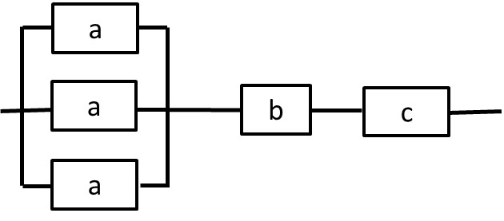
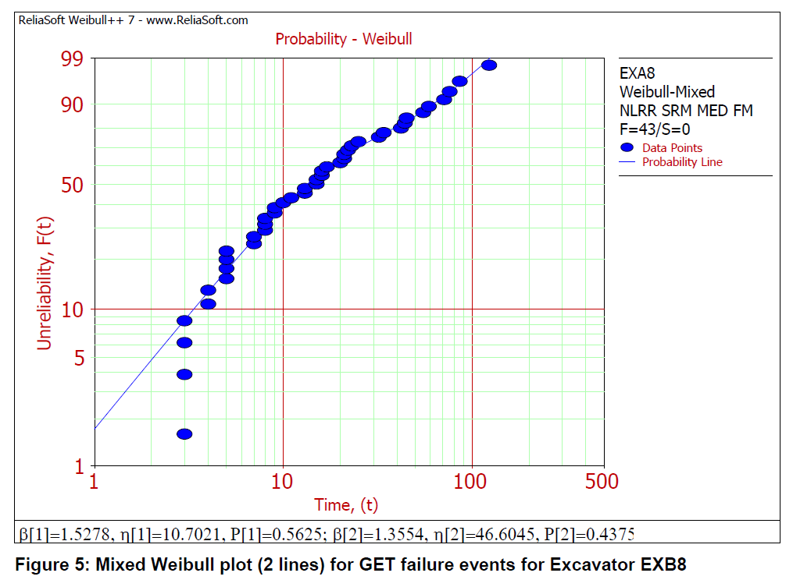

# GENG5507 midsemester statistics question bank

<!-- Question index -->

This bank compiles the actual questions saved in this workspace and the distinct worked examples/prompts in the supplied statistics slides. Questions come first within each item, followed by clearly labelled worked answers. Original numbers, data and available answer choices are retained; some practical wording is tightened without removing subparts. Source ambiguities and corrections are flagged. Course convention: $N(\mu,\sigma^2)$ uses **variance** as its second parameter.

## Contents and source coverage

| Section | Coverage | Status |
|---|---|---|
| [Lecture problems](#lecture-problems) | Lecture 0 background; Weeks 1–5: 3, 3, 2, 3, 4 questions (15 total) | Existing Markdown question/answer files combined; PDFs linked |
| [Practical sheets](#practical-sheets-15) | Sheets 1–5: 4, 8, 5, 3, 5 numbered questions (25 total), all subparts and explicit R exploration prompts | Transcribed from question PDFs; answers checked against solution PDFs |
| [Statistics quizzes](#statistics-quizzes) | Quizzes 1–5: 9, 11, 10, 10, 10 questions (50 total) | Available wording/options and worked answers retained; incomplete Quiz 1 repaired and labelled |
| [2025 midsemester paper](#2025-midsemester-paper--statistics-and-quantitative-reliability) | Q3, Q4, Q8, Q10 and Q13–20 (12 questions) | Includes quantitative engineering/statistics overlap; other paper questions in engineering notes |
| [Slide questions and examples](#additional-questions-and-worked-examples-from-the-statistics-slides) | All seven statistics decks; distinct prompts, examples and graphical-only cases indexed S0–S6 | Mirrored examples combined, image-only prompts inspected |
| [Weekly engineering quizzes](#weekly-engineering-quizzes--quantitative-probability-questions) | All 3 saved Week 4 prompts; Week 5 Q3–Q6 (7 questions) | Full quantitative prompts/options included; qualitative items in engineering notes |

There are **109 numbered lecture, practical, statistics-quiz, weekly-engineering-quiz and selected past-paper questions**, plus the separately indexed slide examples and R exploration prompts. This count treats a multi-part question as one question. The same problem appearing as both a sheet and its solution is included once. Similar questions with different data remain separate. Fresh generated practice is in [examples.md](examples.md), not mixed into the historical bank.

**Answer provenance.** Lecture/quiz/past-paper Markdown already contained worked answers. They are retained as study solutions, with explicit local repairs where needed. Practical answer notes are concise reconciliations with supplied solution PDFs; data-dependent results are marked when quoted rather than recalculated. Missing multiple-choice options are not reconstructed or invented.

## Lecture problems


### Lecture 0 — Westralia case background

**Source transcription:** [00-answer.md](../questions/probability-questions/lecture/00-answer.md). Existing worked answers are study solutions, not a claim of an official marking key.

Source: [Lecture0.pdf](../questions/probability-questions/lecture/Lecture0.pdf)

#### Problem

The case-study document is required reading for the Week 2–5 lecture problems,
but it does not contain standalone questions to solve. It supplies the
engineering context and data used by those questions.

#### Relevant case-study information

The HMAS _Westralia_ fire began when diesel fuel from a burst flexible hose
sprayed onto a hot engine component and ignited. The hose failed after fatigue
cracking of its stainless-steel braid. The repeated pressure pulses in the fuel
system had not been considered when the flexible hoses were selected.

This mechanism matters when choosing a lifetime model: fatigue normally suggests
that failure risk changes with age rather than remaining constant.

##### Rigid-hose repair times

The repair times, in minutes, are

$$
10,\ 17,\ 24,\ 30,\ 14,\ 18,\ 15,\ 13,\ 21.
$$

These data are used in the Week 4 problems.

##### Rigid-hose times between leaks

The case study gives 21 observed times between leaks:

$$
\begin{aligned}
&15,17,30,39,45,80,85,90,120,150,160,190,\\
&240,250,300,400,510,531,601,753,812.
\end{aligned}
$$

Its fitted two-parameter Weibull model has approximately

$$
\beta=1.0107,
\qquad
\eta=259.1574\text{ hours}.
$$

Because $\beta$ is close to $1$, this fitted model has an almost constant hazard
rate for the rigid-hose leak data.

##### Flexible-hose testing

- Supplier A claims a mean time to failure greater than $120$ hours.
- Supplier B's replacement test ran for $300$ hours and recorded four failures;
  the last occurred at $270$ hours.
- The case study instructs the reader to assume independent exponential
  lifetimes when using the Supplier B test data.


### Lecture 1 — Week 1

**Source transcription:** [01-answer.md](../questions/probability-questions/lecture/01-answer.md). Existing worked answers are study solutions, not a claim of an official marking key.

Source: [Lecture1.pdf](../questions/probability-questions/lecture/Lecture1.pdf)

#### L1.1 — Causes of an LNG tank explosion

<!-- Question: L1.1 | Total probability and Bayes: LNG explosion and its possible causes -->

##### Problem

An LNG tank explosion may result from static electricity ($A$), malfunctioning
electrical equipment ($B$), an open flame ($C$), or sabotage ($D$). The estimated
probabilities of the four causes are

$$
P(A)=0.30,\quad P(B)=0.40,\quad P(C)=0.15,\quad P(D)=0.15.
$$

The conditional probabilities of an explosion $E$ given each cause are

$$
P(E\mid A)=0.25,\quad P(E\mid B)=0.20,\quad
P(E\mid C)=0.40,\quad P(E\mid D)=0.75.
$$

1. Find the probability of an explosion.
2. Given that an explosion occurred, find the probability that static
   electricity caused it.

##### Solution

Assuming the four causes are mutually exclusive and exhaustive, the law of
total probability gives

$$
\begin{aligned}
P(E)
&=P(E\mid A)P(A)+P(E\mid B)P(B)\\
&\quad+P(E\mid C)P(C)+P(E\mid D)P(D)\\
&=(0.25)(0.30)+(0.20)(0.40)\\
&\quad +(0.40)(0.15)+(0.75)(0.15)\\
&=0.3275.
\end{aligned}
$$

Therefore,

$$
\boxed{P(E)=0.3275}.
$$

For the second part, Bayes' theorem gives

$$
\begin{aligned}
P(A\mid E)
&=\frac{P(E\mid A)P(A)}{P(E)}\\
&=\frac{(0.25)(0.30)}{0.3275}\\
&=0.2290.
\end{aligned}
$$

Thus,

$$
\boxed{P(A\mid E)\approx0.229}.
$$

The value $0.075$ is $P(A\cap E)$; dividing it by $P(E)$ produces the required
conditional probability.

---

#### L1.2 — LNG tank repair time

<!-- Question: L1.2 | Piecewise repair-time PDF: derive CDF, interval probability and mean -->

##### Problem

The repair time $X$, in hours, has probability density function

$$
f_X(x)=
\begin{cases}
\dfrac{x}{1600}, & 0<x\leq40,\\[6pt]
\dfrac{80-x}{1600}, & 40<x<80,\\[6pt]
0, & \text{otherwise}.
\end{cases}
$$

1. Plot the PDF and CDF.
2. Find $P(60\leq X\leq70)$.
3. Find the mean repair time.

##### Solution

Integrating the PDF gives the CDF

$$
F_X(x)=
\begin{cases}
0, & x\leq0,\\[4pt]
\dfrac{x^2}{3200}, & 0<x\leq40,\\[8pt]
1-\dfrac{(80-x)^2}{3200}, & 40<x<80,\\[8pt]
1, & x\geq80.
\end{cases}
$$

The PDF is triangular: it increases linearly from $0$ to its peak at $x=40$,
then decreases linearly to $0$ at $x=80$. The CDF increases from $0$ to $1$ and
is continuous at $x=40$.

The following R code plots both functions over their full support:

```r
f_X <- function(x) {
  ifelse(x <= 0 | x >= 80, 0,
         ifelse(x <= 40, x / 1600, (80 - x) / 1600))
}

F_X <- function(x) {
  ifelse(x <= 0, 0,
         ifelse(x <= 40, x^2 / 3200,
                ifelse(x < 80, 1 - (80 - x)^2 / 3200, 1)))
}

par(mfrow = c(1, 2))
curve(f_X, from = -5, to = 85, xlab = "Repair time (hours)", ylab = "f_X(x)")
curve(F_X, from = -5, to = 85, xlab = "Repair time (hours)", ylab = "F_X(x)")
```

For a repair time between $60$ and $70$ hours,

$$
\begin{aligned}
P(60\leq X\leq70)
&=F_X(70)-F_X(60)\\
&=\left(1-\frac{10^2}{3200}\right)
 -\left(1-\frac{20^2}{3200}\right)\\
&=\frac{300}{3200}\\
&=0.09375.
\end{aligned}
$$

Therefore,

$$
\boxed{P(60\leq X\leq70)=0.09375}.
$$

The mean is

$$
\begin{aligned}
E[X]
&=\int_0^{40}x\frac{x}{1600}\,dx
  +\int_{40}^{80}x\frac{80-x}{1600}\,dx\\
&=13.3333+26.6667\\
&=40.
\end{aligned}
$$

Hence the mean repair time is

$$
\boxed{E[X]=40\text{ hours}}.
$$

This also follows from the symmetry of the triangular density about $x=40$.

---

#### L1.3 — Car-battery lifetimes

<!-- Question: L1.3 | Battery lifetime data: histogram, sample mean and standard deviation -->

##### Problem

The lifetimes, in years, of ten car batteries are

$$
4.8,\ 3.9,\ 2.2,\ 5.1,\ 4.6,\ 5.3,\ 6.3,\ 4.3,\ 6.8,\ 4.7.
$$

1. Draw a histogram of the data in RStudio.
2. Estimate the mean and standard deviation of battery lifetime.

##### Solution

```r
life.time <- c(4.8, 3.9, 2.2, 5.1, 4.6,
               5.3, 6.3, 4.3, 6.8, 4.7)

hist(life.time,
     main = "Histogram of Battery Lifetimes",
     xlab = "Lifetime (years)")

mean(life.time)
sd(life.time)
```

R returns

$$
\bar{x}=4.8000,
\qquad
s=1.2675.
$$

Therefore, the estimated mean and sample standard deviation are

$$
\boxed{\bar{x}=4.80\text{ years}},
\qquad
\boxed{s\approx1.27\text{ years}}.
$$

R's `sd()` uses the sample standard deviation with denominator $n-1$.


### Lecture 2 — Week 2

**Source transcription:** [02-answer.md](../questions/probability-questions/lecture/02-answer.md). Existing worked answers are study solutions, not a claim of an official marking key.

Source: [Lecture2.pdf](../questions/probability-questions/lecture/Lecture2.pdf)

Let $\Phi$ denote the standard normal CDF and $\Phi^{-1}$ its quantile
function.

#### L2.1 — Normal lifetime model

<!-- Question: L2.1 | Normal hose lifetime: lower/upper tails and a survival quantile -->

##### Problem

Suppose the flexible-hose lifetime is

$$
X\sim N(125,14^2)\text{ hours}.
$$

Evaluate and interpret:

1. $P(X<120)$;
2. $P(X>130)$;
3. the value $c$ such that $P(X>c)=0.99$.

##### Solution

For $X<120$, standardising gives

$$
\begin{aligned}
P(X<120)
&=\Phi\left(\frac{120-125}{14}\right)\\
&=\Phi(-0.3571)\\
&=0.3605.
\end{aligned}
$$

Thus, the model predicts that approximately

$$
\boxed{36.05\%}
$$

of flexible hoses fail before $120$ hours.

Similarly,

$$
\begin{aligned}
P(X>130)
&=1-\Phi\left(\frac{130-125}{14}\right)\\
&=1-\Phi(0.3571)\\
&=0.3605.
\end{aligned}
$$

Approximately $36.05\%$ of hoses therefore last longer than $130$ hours. The
two probabilities are equal because $120$ and $130$ are equally distant from
the mean of $125$ hours.

For $P(X>c)=0.99$, the lower-tail probability is $P(X\leq c)=0.01$. Hence

$$
\begin{aligned}
c
&=125+14\Phi^{-1}(0.01)\\
&=125+14(-2.3263)\\
&=92.4311.
\end{aligned}
$$

Therefore,

$$
\boxed{c\approx92.43\text{ hours}}.
$$

Under the model, $99\%$ of hoses last longer than about $92.43$ hours.

---

#### L2.2 — Uniform lifetime model

<!-- Question: L2.2 | Uniform hose lifetime: failure probability and a survival quantile -->

##### Problem

Suppose the flexible-hose lifetime is

$$
X\sim\operatorname{Uniform}[85,165]\text{ hours}.
$$

Evaluate and interpret:

1. $P(X<120)$;
2. the value $c$ such that $P(X>c)=0.99$.

##### Solution

The total interval length is $165-85=80$ hours. Therefore,

$$
P(X<120)=\frac{120-85}{165-85}=\frac{35}{80}=0.4375.
$$

The model predicts that

$$
\boxed{43.75\%}
$$

of hoses fail before $120$ hours.

For $85\leq c\leq165$,

$$
P(X>c)=\frac{165-c}{80}.
$$

Setting this probability equal to $0.99$ gives

$$
\frac{165-c}{80}=0.99
\quad\Rightarrow\quad
c=165-79.2=85.8.
$$

Thus,

$$
\boxed{c=85.8\text{ hours}}.
$$

Under the model, $99\%$ of hoses last longer than $85.8$ hours.

---

#### L2.3 — Lognormal lifetime model

<!-- Question: L2.3 | Lognormal hose lifetime: failure probability and a survival quantile -->

##### Problem

Suppose $X$ has a lognormal distribution with $\mu=4.82$ and $\sigma=0.03$.
Evaluate and interpret:

1. $P(X<120)$;
2. the value $c$ such that $P(X>c)=0.99$.

##### Solution

For this parameterisation,

$$
\ln X\sim N(4.82,0.03^2).
$$

Therefore,

$$
\begin{aligned}
P(X<120)
&=P(\ln X<\ln120)\\
&=\Phi\left(\frac{\ln120-4.82}{0.03}\right)\\
&=\Phi(-1.0836)\\
&=0.1393.
\end{aligned}
$$

The model predicts that approximately

$$
\boxed{13.93\%}
$$

of hoses fail before $120$ hours.

For $P(X>c)=0.99$, $P(X\leq c)=0.01$. Taking logarithms,

$$
\begin{aligned}
\ln c&=4.82+0.03\Phi^{-1}(0.01)\\
&=4.75021,
\end{aligned}
$$

so

$$
c=e^{4.75021}=115.6085.
$$

Therefore,

$$
\boxed{c\approx115.61\text{ hours}}.
$$

Under the lognormal model, $99\%$ of hoses last longer than about $115.61$
hours.


### Lecture 3 — Week 3

**Source transcription:** [03-answer.md](../questions/probability-questions/lecture/03-answer.md). Existing worked answers are study solutions, not a claim of an official marking key.

Source: [Lecture3.pdf](../questions/probability-questions/lecture/Lecture3.pdf)

#### L3.1 — Exponential lifetime model

<!-- Question: L3.1 | Exponential lifetime: PDF, reliability, hazard, median, MTTF and variance -->

##### Problem

Suppose the flexible-hose lifetime $X$, in hours, is exponentially distributed
with failure rate

$$
\lambda=0.008\text{ per hour}.
$$

1. Write down the PDF.
2. Derive the survival and hazard-rate functions.
3. Find the median lifetime.
4. Find the proportion expected to fail before $125$ hours.
5. Derive the mean time to failure and variance.
6. Assess whether the model is reasonable for flexible-hose lifetimes.

##### Solution

The exponential PDF is

$$
f_X(x)=
\begin{cases}
\lambda e^{-\lambda x}=0.008e^{-0.008x}, & x\geq0,\\
0, & x<0.
\end{cases}
$$

For $t\geq0$, the survival function is

$$
\begin{aligned}
S(t)
&=P(X>t)\\
&=\int_t^\infty \lambda e^{-\lambda x}\,dx\\
&=e^{-\lambda t}=e^{-0.008t}.
\end{aligned}
$$

The hazard rate is therefore constant:

$$
h(t)=\frac{f_X(t)}{S(t)}
=\frac{\lambda e^{-\lambda t}}{e^{-\lambda t}}
=\lambda
=\boxed{0.008\text{ per hour}}.
$$

If $m$ is the median, $P(X\leq m)=0.5$, or equivalently $S(m)=0.5$.
Thus,

$$
e^{-0.008m}=0.5
\quad\Rightarrow\quad
m=\frac{\ln2}{0.008}=86.6434.
$$

Hence,

$$
\boxed{m\approx86.64\text{ hours}}.
$$

The proportion that fails before $125$ hours is

$$
\begin{aligned}
P(X<125)
&=1-S(125)\\
&=1-e^{-0.008(125)}\\
&=1-e^{-1}\\
&=0.6321.
\end{aligned}
$$

Thus, approximately

$$
\boxed{63.21\%}
$$

of hoses are expected to fail before $125$ hours.

For an exponential random variable,

$$
E[X]=\frac{1}{\lambda},
\qquad
E[X^2]=\frac{2}{\lambda^2}.
$$

Consequently,

$$
\operatorname{Var}(X)
=E[X^2]-E[X]^2
=\frac{1}{\lambda^2}.
$$

Substituting $\lambda=0.008$ gives

$$
\boxed{\operatorname{MTTF}=E[X]=125\text{ hours}}
$$

and

$$
\boxed{\operatorname{Var}(X)=15{,}625\text{ hours}^2}.
$$

The exponential model assumes a constant hazard and has the memoryless
property. That is questionable here because the case study attributes the hose
failures to fatigue caused by repeated pressure pulses; accumulated fatigue
would normally make hazard increase with age. The exponential model could still
be a useful approximation over a limited operating range if data showed an
approximately constant failure rate, but the mechanism alone does not support
that assumption.

---

#### L3.2 — Weibull lifetime model

<!-- Question: L3.2 | Weibull lifetime: PDF, reliability, hazard, median and MTTF -->

##### Problem

Suppose the flexible-hose lifetime $X$, in hours, follows a Weibull distribution
with shape $\beta=0.5$ and scale $\eta=125$.

1. Write down the PDF.
2. Write down the survival and hazard-rate functions.
3. Find the median lifetime.
4. Find the proportion expected to fail before $125$ hours.
5. Find the mean time to failure.
6. Assess whether the model is reasonable for flexible-hose lifetimes.

##### Solution

Using the shape-scale parameterisation, the Weibull PDF is

$$
f_X(x)=
\begin{cases}
\dfrac{\beta}{\eta}
\left(\dfrac{x}{\eta}\right)^{\beta-1}
\exp\left[-\left(\dfrac{x}{\eta}\right)^\beta\right], & x>0,\\[10pt]
0, & x\leq0.
\end{cases}
$$

With $\beta=0.5$ and $\eta=125$,

$$
f_X(x)=\frac{0.5}{125}
\left(\frac{x}{125}\right)^{-0.5}
\exp\left[-\left(\frac{x}{125}\right)^{0.5}\right],
\qquad x>0.
$$

The survival function is

$$
S(t)=\exp\left[-\left(\frac{t}{125}\right)^{0.5}\right],
\qquad t\geq0,
$$

and the hazard rate is

$$
h(t)=\frac{0.5}{125}
\left(\frac{t}{125}\right)^{-0.5},
\qquad t>0.
$$

The median $m$ satisfies $S(m)=0.5$:

$$
\exp\left[-\left(\frac{m}{125}\right)^{0.5}\right]=0.5.
$$

Therefore,

$$
m=125(\ln2)^{1/0.5}
=125(\ln2)^2
=60.0566,
$$

so

$$
\boxed{m\approx60.06\text{ hours}}.
$$

At $t=125$ hours,

$$
\begin{aligned}
P(X<125)
&=1-S(125)\\
&=1-\exp[-(125/125)^{0.5}]\\
&=1-e^{-1}\\
&=0.6321.
\end{aligned}
$$

Thus, approximately

$$
\boxed{63.21\%}
$$

of hoses are expected to fail before $125$ hours.

The Weibull mean is

$$
E[X]=\eta\,\Gamma\left(1+\frac{1}{\beta}\right).
$$

Hence,

$$
E[X]=125\,\Gamma(3)=125(2)=250,
$$

and

$$
\boxed{\operatorname{MTTF}=250\text{ hours}}.
$$

Because $\beta=0.5<1$, this model has a decreasing hazard rate: it implies that
the hoses surviving early life become less likely to fail as they age. That can
represent early manufacturing defects, but it is not consistent with a pure
fatigue or wear-out mechanism, which would usually require $\beta>1$ and an
increasing hazard. The proposed parameter value is therefore not well supported
by the failure mechanism unless separate evidence shows strong early-life
failures.


### Lecture 4 — Week 4

**Source transcription:** [04-answer.md](../questions/probability-questions/lecture/04-answer.md). Existing worked answers are study solutions, not a claim of an official marking key.

Source: [Lecture4.pdf](../questions/probability-questions/lecture/Lecture4.pdf)

The rigid-hose repair times, in minutes, are

$$
10,\ 17,\ 24,\ 30,\ 14,\ 18,\ 15,\ 13,\ 21.
$$

The solutions below use maximum-likelihood estimates (MLEs). Because R's `sd()`
uses the denominator $n-1$, the corresponding sample standard deviations are
also reported where relevant.

#### L4.1 — Normal model

<!-- Question: L4.1 | Fit Normal mean and standard deviation to repair-time data -->

##### Problem

Fit a normal model $N(\mu,\sigma^2)$ to the repair-time data. Estimate $\mu$ and
$\sigma$.

##### Solution

For a normal model, the MLEs are

$$
\hat\mu=\bar{x}
\qquad\text{and}\qquad
\hat\sigma
=\sqrt{\frac{1}{n}\sum_{i=1}^n(x_i-\bar{x})^2}.
$$

The sample mean is

$$
\bar{x}=\frac{10+17+24+30+14+18+15+13+21}{9}=18.
$$

Therefore,

$$
\hat\sigma
=\sqrt{\frac{1}{9}\sum_{i=1}^9(x_i-18)^2}
=5.8119.
$$

The fitted normal model is

$$
\boxed{X\sim N(18,5.8119^2)}.
$$

If the question instead intends the usual sample standard deviation, then

$$
s=\sqrt{\frac{1}{8}\sum_{i=1}^9(x_i-18)^2}=6.1644\text{ minutes}.
$$

---

#### L4.2 — Lognormal model

<!-- Question: L4.2 | Fit lognormal parameters to repair-time data -->

##### Problem

Fit a lognormal model $LN(\mu,\sigma^2)$ to the repair-time data. Estimate
$\mu$ and $\sigma$.

##### Solution

For this parameterisation,

$$
Y=\ln X\sim N(\mu,\sigma^2).
$$

The MLEs are therefore the mean and MLE standard deviation of the log-transformed
observations:

$$
\hat\mu=\frac{1}{n}\sum_{i=1}^n\ln x_i
=2.84022
$$

and

$$
\hat\sigma
=\sqrt{\frac{1}{n}\sum_{i=1}^n(\ln x_i-\hat\mu)^2}
=0.31551.
$$

Thus, the fitted model is

$$
\boxed{X\sim LN(2.84022,0.31551^2)}.
$$

Using the $n-1$ denominator instead gives a log-scale sample standard deviation
of

$$
s_{\ln X}=0.33464.
$$

---

#### L4.3 — Exponential model

<!-- Question: L4.3 | Fit an exponential rate to repair times and assess suitability -->

##### Problem

Fit an exponential model $\operatorname{Exp}(\lambda)$ to the repair-time data.
Estimate $\lambda$ and explain whether the model appears suitable.

##### Solution

For an exponential model parameterised by rate, the MLE is

$$
\hat\lambda=\frac{1}{\bar{x}}.
$$

Since $\bar{x}=18$ minutes,

$$
\boxed{\hat\lambda=\frac{1}{18}=0.05556\text{ min}^{-1}}.
$$

The fitted exponential model has both mean and standard deviation equal to
$18$ minutes. The observed sample standard deviation is only $6.1644$ minutes,
giving an observed coefficient of variation

$$
\frac{s}{\bar{x}}=\frac{6.1644}{18}=0.3425,
$$

whereas an exponential distribution has coefficient of variation $1$. An
exponential density also places its greatest probability density near zero,
while every observed repair time is between $10$ and $30$ minutes.

The exponential model therefore appears to be a poor fit to these data. The
sample contains only nine observations, so this is a diagnostic conclusion
rather than a definitive goodness-of-fit test.

The following R code reproduces all estimates:

```r
x <- c(10, 17, 24, 30, 14, 18, 15, 13, 21)

mu_normal <- mean(x)
sigma_normal_mle <- sqrt(mean((x - mu_normal)^2))
sigma_normal_sample <- sd(x)

log_x <- log(x)
mu_lognormal <- mean(log_x)
sigma_lognormal_mle <- sqrt(mean((log_x - mu_lognormal)^2))
sigma_lognormal_sample <- sd(log_x)

lambda_exponential <- 1 / mean(x)
```


### Lecture 5 — Week 5

**Source transcription:** [05-answer.md](../questions/probability-questions/lecture/05-answer.md). Existing worked answers are study solutions, not a claim of an official marking key.

Source: [Lecture5.pdf](../questions/probability-questions/lecture/Lecture5.pdf)

Let $T$ denote the time between rigid-hose failures, with $E[T]=\mu$ and
$\operatorname{Var}(T)=\sigma^2$.

#### L5.1 — One normally distributed lifetime

<!-- Question: L5.1 | One Normal lifetime: survival probability and an upper-tail quantile -->

##### Problem

Suppose

$$
T\sim N(300,15^2)\text{ hours}.
$$

1. Find the probability that a rigid hose lasts at least $310$ hours.
2. Find $t$ such that $P(T>t)=0.025$.

##### Solution

For the first part,

$$
\begin{aligned}
P(T\geq310)
&=P\left(Z\geq\frac{310-300}{15}\right)\\
&=P(Z\geq0.6667)\\
&=0.2525.
\end{aligned}
$$

Therefore,

$$
\boxed{P(T\geq310)\approx0.2525}.
$$

For $P(T>t)=0.025$, $t$ is the $97.5$th percentile of the normal distribution:

$$
\begin{aligned}
t
&=300+15z_{0.975}\\
&=300+15(1.95996)\\
&=329.3995.
\end{aligned}
$$

Thus,

$$
\boxed{t\approx329.40\text{ hours}}.
$$

---

#### L5.2 — Mean lifetime with known standard deviation

<!-- Question: L5.2 | Normal sample mean with known SD: tail probability and minimum sample size -->

##### Problem

Suppose individual lifetimes are independent and normally distributed with mean
$300$ hours and standard deviation $15$ hours. Let $\bar T$ be the sample mean.

1. For $n=10$, specify the distribution of $\bar T$.
2. For $n=10$, find $P(\bar T\geq310)$.
3. Find the minimum sample size $n$ such that
   $P(\bar T\geq310)\leq0.005$.

##### Solution

For independent normal observations,

$$
\bar T\sim N\left(300,\frac{15^2}{n}\right).
$$

When $n=10$,

$$
\boxed{\bar T\sim N\left(300,\frac{15^2}{10}\right)},
$$

so the standard deviation of $\bar T$ is $15/\sqrt{10}=4.7434$ hours.

Therefore,

$$
\begin{aligned}
P(\bar T\geq310)
&=P\left(Z\geq\frac{310-300}{15/\sqrt{10}}\right)\\
&=P(Z\geq2.1082)\\
&=0.01751.
\end{aligned}
$$

Thus,

$$
\boxed{P(\bar T\geq310)\approx0.01751}.
$$

For the required sample size,

$$
P(\bar T\geq310)
=1-\Phi\left(\frac{10\sqrt n}{15}\right)\leq0.005.
$$

Hence,

$$
\frac{10\sqrt n}{15}\geq z_{0.995}=2.57583,
$$

which gives

$$
n\geq\left(\frac{15(2.57583)}{10}\right)^2
=14.9285.
$$

The minimum integer sample size is therefore

$$
\boxed{n=15}.
$$

For $n=15$, the upper-tail probability is approximately $0.004912$, which is
below $0.005$.

---

#### L5.3 — Mean lifetime with unknown standard deviation

<!-- Question: L5.3 | Unknown population SD: standardised sample mean, t tails and sample size -->

##### Problem

Suppose individual lifetimes are independent and normally distributed with mean
$300$ hours, but $\sigma$ is unknown. Let $S$ be the sample standard deviation.

1. For $n=10$, specify the distribution of
   $\dfrac{\bar T-\mu}{S/\sqrt n}$.
2. For $n=10$, find
   $P\left(\dfrac{\bar T-\mu}{S/\sqrt n}>2.262\right)$.
3. Find the minimum $n$ such that
   $P\left(\dfrac{\bar T-\mu}{S/\sqrt n}>2.947\right)\leq0.005$.

##### Solution

For a normal population with unknown variance,

$$
\frac{\bar T-\mu}{S/\sqrt n}\sim t_{n-1}.
$$

When $n=10$,

$$
\boxed{\frac{\bar T-\mu}{S/\sqrt{10}}\sim t_9}.
$$

Therefore,

$$
\begin{aligned}
P\left(\frac{\bar T-\mu}{S/\sqrt{10}}>2.262\right)
&=P(t_9>2.262)\\
&\approx0.02501.
\end{aligned}
$$

Thus,

$$
\boxed{P\left(\frac{\bar T-\mu}{S/\sqrt{10}}>2.262\right)\approx0.025}.
$$

For the final part, find the smallest $n$ satisfying

$$
P(t_{n-1}>2.947)\leq0.005.
$$

Checking successive degrees of freedom gives

$$
P(t_{14}>2.947)=0.005304>0.005
$$

but

$$
P(t_{15}>2.947)=0.004997\leq0.005.
$$

Since $n-1=15$, the minimum sample size is

$$
\boxed{n=16}.
$$

---

#### L5.4 — Unknown lifetime distribution

<!-- Question: L5.4 | Unknown lifetime distribution: approximate sample-mean probability -->

##### Problem

Suppose individual lifetimes have mean $300$ hours and standard deviation $15$
hours, but their distribution is unknown. For $n=40$ independent hoses:

1. Specify the distribution of $\bar T$.
2. Approximate $P(\bar T\geq310)$.

##### Solution

The exact distribution of $\bar T$ cannot be determined without the population
distribution. By the central limit theorem, however,

$$
\bar T\ \dot\sim\ N\left(300,\frac{15^2}{40}\right),
$$

where $\dot\sim$ denotes an approximate distribution. Its standard deviation is
$15/\sqrt{40}=2.3717$ hours.

Therefore,

$$
\begin{aligned}
P(\bar T\geq310)
&\approx P\left(Z\geq\frac{310-300}{15/\sqrt{40}}\right)\\
&=P(Z\geq4.2164)\\
&\approx1.2413\times10^{-5}.
\end{aligned}
$$

Hence,

$$
\boxed{P(\bar T\geq310)\approx0.0000124}.
$$

Because this is a very far-tail probability and the population distribution is
unknown, the numerical value should be treated as a normal approximation rather
than an exact probability.


## Practical sheets 1–5

The original PDFs contain background revision and R demonstrations as well as questions. Every numbered problem and subpart is retained below; repeated revision formulas are in [the cheat sheet](cheatsheet.md), and the R demonstrations are in [the R guide](R.md). **Answer notes** are concise worked summaries checked against the supplied solution PDFs, with corrections distinguished explicitly. An unavailable data file is not an invitation to invent observations.

### Practical 1 — conditional probability, Gamma and R

Sources: [question sheet](../questions/probability-questions/prac/prac-sheet-1.pdf) · [supplied solutions](../questions/probability-questions/prac/prac-sheet-1-solution.pdf).

#### P1.1 — corrosion test (Textbook Problem 3.79, adapted)

<!-- Question: P1.1 | Corrosion screening: infer prevalence and reverse conditional probabilities -->

Engineers maintaining nuclear submarines must check cooling-system pipes for internal corrosion. A non-destructive test is not infallible. Let $A$ mean actual corrosion and $B$ mean the test indicates corrosion. The test detects corrosion with $P(B\mid A)=0.7$ and falsely indicates corrosion with $P(B\mid A^c)=0.2$. One in every four tests indicates corrosion: $P(B)=0.25$.

(a) Find $P(A)$, using a tree diagram and/or total probability. (b) Find the probability of corrosion given a positive test. (c) Find the probability of corrosion given a negative test.

**Answer notes.** $0.25=0.7p+0.2(1-p)$ gives $p=0.1$; $P(A\mid B)=0.07/0.25=0.28$; $P(A\mid B^c)=0.03/0.75=0.04$. Complement bars lost in PDF extraction have been restored.

#### P1.2 — printed circuit boards (Textbook Problem 3.80)

<!-- Question: P1.2 | Circuit-board screening: infer defect rate and probability given a test result -->

Let $A$ mean a board is defective and $B$ mean it passes an automated verification test. Of 900 completed boards, 890 passed. In a separate study, 5 of 30 deliberately defective boards passed. Interpret long-run relative frequencies as probabilities.

(a) Estimate $P(B\mid A)$. (b) Assuming $P(B\mid A^c)=1$ (a good board cannot fail), estimate $P(A)$ using total probability. (c) Estimate the probability that a board is defective given that it passed.

**Answer notes.** $P(B\mid A)\approx1/6$; $890/900=p/6+(1-p)$ gives $p=1/75$; $P(A\mid B)\approx(1/450)/(89/90)=1/445\approx0.002247$.

#### P1.3 — mercury discharge and financial risk

<!-- Question: P1.3 | Mercury-discharge PDF: moments, exceedance probabilities and expected fines -->

Mercury concentration $X$ (units/litre) in weekly tests of a water-treatment plant varies day to day without a long-term trend. Model it as Gamma with shape $\alpha=2$ and scale $\beta=1$.

(a) Verify that $f_X(x)=xe^{-x}$ for $x\ge0$, zero otherwise, using $\Gamma(\alpha)=(\alpha-1)!$ for positive integer $\alpha$.

(b) Show that

$$
F_X(x)=\begin{cases}1-(1+x)e^{-x},&x>0,\\0,&x\le0.\end{cases}
$$

Hint: integration by parts gives $\int_0^x ue^{-u}\,du=[-ue^{-u}]_0^x+\int_0^x e^{-u}\,du$.

(c) Determine the mean and variance using the Gamma formulas.

A fine is imposed whenever the measured concentration exceeds $T$ units/litre.

(d) Comment on the fairness of fixed testing limits. Do short-term variations result in higher financial risk?

(e) Express the probability of financial loss in terms of $T$. Evaluate it for $T=4$ and $T=3$. Mark these probabilities on the graphs in (b) and (d). **Source issue:** those subparts do not explicitly request graphs; plots of the PDF/CDF are requested in P2.3.

(f) Compare expected total payments per fortnight for (i) weekly tests with a fine of $C$ each time $X>4$, and (ii) fortnightly tests with a fine of $C$ each time $X>3$.

**Answer notes.** $E(X)=2$, $\operatorname{Var}(X)=2$; $P(X>T)=(1+T)e^{-T}$ for $T\ge0$. At 4 this is $0.09158$, and at 3 it is $0.19915$. Expected fortnightly fines are $2C(5e^{-4})=0.18316C$ versus $C(4e^{-3})=0.19915C$, so weekly testing is cheaper under this model. A fixed limit penalises occasional exceedances even if average discharge is low; the exceedance probability, not just the mean, determines expected fines. Greater variability does not universally increase every tail probability at every threshold.

#### P1.R — explicit R demonstration prompts

<!-- Question: P1.R | R exploration: Normal functions, standardisation and reproducible samples -->

Run and compare `pnorm(0.3)`, `pnorm(2, lower.tail=FALSE)`, and `pnorm(9, mean=6, sd=10)`. Explain why the first and third agree, and why `pnorm(9)` differs from the third. Run `qnorm(0.025)`, `qnorm(0.05, lower.tail=FALSE)` and `qnorm(0.1, mean=6, sd=10)`; sketch the Normal symmetry behind the opposite-tail quantiles. Run `rnorm(4)` twice, then `mean(rnorm(4))`; explain why these are different samples. Store `x <- rnorm(4)` and reuse `x`. Repeat `set.seed(5507); x <- rnorm(6, mean=10, sd=5)` to check reproducibility. For `y <- c(4,3,3,7,5,2,1,0,1,2,4,3,2)`, try `mean(y)`, `median(y)`, `sd(y)` and `summary(y)`.

**Answer notes.** Standardisation gives $(9-6)/10=0.3$; the default Normal has mean 0 and SD 1. Re-running a generator advances its random-number state; storing a sample or resetting the seed preserves reproducibility. See [R guide](R.md) for executable examples.

#### P1.4 — Normal calculations and simulation

<!-- Question: P1.4 | Normal probabilities and quantiles; simulate and summarise a sample in R -->

(a) For $Z\sim N(0,1)$ find using R: (i) $P(Z>2)$; (ii) $P(0.2<Z<0.57)$; (iii) $z$ such that $P(Z<z)=0.975$.

(b) For $X\sim N(3,2^2)$ find: (i) $P(X<3.5)$; (ii) $P(|X-3|\ge2)$; (iii) $x$ such that $P(X>x)=0.1$.

(c) Use `set.seed(1234)` and generate `x`, a sample of 100 observations from $N(20,5^2)$. (i) Calculate the sample mean, median and SD. (ii) Compare with the corresponding population parameters and explain whether the result is expected. (iii) Plot `boxplot(x)`. (iv) Plot a histogram and overlay the generating Normal density; run the following line by line:

```r
hist(x, freq=FALSE)
curve(dnorm(x, 20, 5), from=5, to=35, col="red", add=TRUE)
text(x=26, y=0.08, "N(20, 5^2) pdf", col="red")
```

**Answer notes.** (a) $0.02275$, $0.13640$, $1.95996$. (b) $0.59871$, $0.31731$, $5.56310$. For the specified seed, sample mean $19.21619$, median $18.07686$ and SD $5.02203$. Sample statistics fluctuate around the population mean/median 20 and SD 5; they need not equal them. The histogram must use density scale for a PDF overlay.

### Practical 2 — probability distributions

Sources: [question sheet](../questions/probability-questions/prac/prac-sheet-2.pdf) · [supplied solutions](../questions/probability-questions/prac/prac-sheet-2-solution.pdf).

#### P2.1 — defective resistors (Textbook Problem 2.10)

<!-- Question: P2.1 | Defective resistors: probability of more than one defect in ten -->

A random sample of 10 resistors is tested; each has probability 0.08 of being defective. Let $X$ count defective resistors. (a) Recommend a distribution. (b) Find the probability of more than one defective resistor.

**Answer notes.** Assuming independent outcomes and a common defect probability, $X\sim\operatorname{Bin}(10,0.08)$ and $P(X>1)=1-0.92^{10}-10(0.08)0.92^9\approx0.18788$.

#### P2.2 — elevator and passenger arrivals (Textbook Problem 2.24, adapted)

<!-- Question: P2.2 | Independent arrival streams: elevator and passenger counts in one minute -->

A proposed 10-passenger elevator arrives in the lobby on average once per minute. Five passengers per minute are expected to use it; the company rejects the proposal.

(a) Support the proposal by calculating the probability that, in a given minute, the elevator does not show up and at least 10 passengers arrive. Hint: $\sum_{n=0}^9 5^ne^{-5}/n!\approx0.968$. (b) Find the probability that the elevator arrives only once in a five-minute period.

**Answer notes.** Model arrivals as independent Poisson processes with rates 1/min and 5/min. (a) $e^{-1}[1-P(\operatorname{Pois}(5)\le9)]\approx0.01171$. (b) $5e^{-5}\approx0.03369$. The sheet's duplicated “not” is a typographical error; its solution uses no elevator arrival.

#### P2.3 — Gamma plots, continuing P1.3

<!-- Question: P2.3 | Plot Gamma PDF and CDF in R; define and plot a function -->

For $f_X(x)=xe^{-x}$ on $x\ge0$ and $F_X(x)=1-(1+x)e^{-x}$ on $x>0$ (zero outside their lower support), (a) plot the PDF using R; (b) plot the CDF using R.

**Answer notes.** Use `curve(dgamma(x, shape=2, scale=1), 0, 10)` and `curve(pgamma(x, shape=2, scale=1), 0, 10)`. The introductory exercise also asks you to define `fn <- function(x) x^2` and plot it from $-2$ to $2$, labelling the axis and title with `ylab` and `main=expression(f(x)==x^2)`.

#### P2.4 — chain-link lengths (Textbook Problem 2.22)

<!-- Question: P2.4 | Uniform chain-link lengths: PDF, CDF, mean and variance -->

Individual chain-link lengths have the uniform PDF shown in the [source figure, page 2](../questions/probability-questions/prac/prac-sheet-2.pdf#page=2): a rectangle from $m-a/2$ to $m+a/2$.

(a) Determine the rectangle's height. (b) Find the CDF, sketch it and label the axes. (c) Calculate the mean and variance. **Numbering correction:** the source labels both final parts “(b)”.

**Answer notes.** Height $1/a$; CDF 0 below $m-a/2$, $(x-m+a/2)/a$ within the interval and 1 above $m+a/2$; mean $m$, variance $a^2/12$.

#### P2.5 — standard Normal and underweight cereal

<!-- Question: P2.5 | Normal tails and quantiles; choose SD to limit underweight cereal -->

For standard Normal $Z$: (a) find $P(-0.34<Z<0.68)$; (b) find $k$ such that $P(Z>k)=0.025$.

A cereal-filling machine gives Normally distributed weights with mean 405 g and SD 10 g. Labels state 400 g; boxes below 398 g are “underweight”. (c) Find the long-run proportion underweight. (d) With the same mean, to what SD must the manufacturer reduce variability to make the proportion underweight 1%?

**Answer notes.** (a) $\Phi(0.68)-\Phi(-0.34)\approx0.38482$; (b) $1.95996$; (c) $\Phi(-0.7)=0.24196$; (d) $\sigma=(398-405)/\Phi^{-1}(0.01)\approx3.009$ g.

#### P2.6 — lognormal

<!-- Question: P2.6 | Lognormal lifetime: probability, mean and standard deviation -->

$T$ is lognormal with log-scale parameters $\mu=-1$, $\sigma=2$. (a) Find $P(T<3)$. (b) Find the mean and SD of $T$.

**Answer notes.** $\Phi((\ln3+1)/2)\approx0.8530$; $E(T)=e^1\approx2.7183$; $\operatorname{SD}(T)=\sqrt{(e^4-1)e^2}\approx19.901$.

#### P2.7 — exponential cycles and a series system

<!-- Question: P2.7 | Exponential lifetime: mean, survival given age and series-system reliability -->

A device's cycles-to-failure $T$ is exponential with rate $\lambda=0.003$ failures/cycle. (a) Determine mean cycles to failure. (b) Given survival through 300 cycles, find the probability that it fails after 1000 cycles. (c) Find the probability that a new device does not fail in its first 700 cycles.

Independent $X_1\sim\operatorname{Exp}(0.002)$, $X_2\sim\operatorname{Exp}(0.003)$ and $X_3\sim\operatorname{Exp}(0.005)$ are given. (d) For $Y=\min(X_1,X_2,X_3)$, find $P(Y>300)$.

**Answer notes.** (a) $333.333$ cycles; (b) $P(T>1000\mid T>300)=e^{-0.003(700)}=0.122456$; (c) the same by memorylessness; (d) $e^{-(0.002+0.003+0.005)300}=e^{-3}=0.049787$.

#### P2.8 — Weibull lifetime

<!-- Question: P2.8 | Weibull lifetime: PDF, mean, variance and failure probability -->

A component's lifetime $T$ in years has shape $\beta=0.5$ and scale $\eta=0.25$. (a) Write its PDF. (b) Graph the PDF in R. (c) Find its mean and variance, using $\Gamma(n)=(n-1)!$. (d) Find the probability of failure within one year.

**Answer notes.** For $t>0$, $f(t)=t^{-1/2}e^{-2\sqrt t}$, and zero for $t<0$; plot away from zero because the density diverges there. Mean $0.25\Gamma(3)=0.5$ yr; variance $0.25^2[\Gamma(5)-\Gamma(3)^2]=1.25$ yr${}^2$; $F(1)=1-e^{-2}=0.864665$.

### Practical 3 — hazard, MTTF and Weibull plots

Sources: [question sheet](../questions/probability-questions/prac/prac-sheet-3.pdf) · [supplied solutions](../questions/probability-questions/prac/prac-sheet-3-solution.pdf).

#### P3.1 — derive hazard functions

<!-- Question: P3.1 | Derive exponential and Weibull hazard functions -->

Use the expressions for PDF and CDF to derive hazard rates for (a) exponential lifetime with rate $1/\eta$; (b) Weibull lifetime with shape $\beta$ and characteristic life $\eta$.

**Answer notes.** $h(t)=f(t)/[1-F(t)]$ gives $1/\eta$ and $(\beta/\eta)(t/\eta)^{\beta-1}$, respectively. **Source correction:** the background's alternative Weibull parameterisation mixes incompatible PDF/CDF expressions. If the CDF is $1-e^{-\alpha t^\beta}$, then $\eta=\alpha^{-1/\beta}$; if it is $1-e^{-(t/\alpha)^\beta}$, then $\alpha=\eta$.

#### P3.2 — exponential hazard interpretation

<!-- Question: P3.2 | Interpret an exponential hazard rate; find MTTF and standard deviation -->

A component lifetime in years has $f(t)=\lambda e^{-\lambda t}$, $t>0$, with $\lambda=2$. This is Weibull with $\beta=1$, $\eta=1/\lambda$. (a) Write the hazard and interpret it. (b) Calculate MTTF and SD.

**Answer notes.** $h(t)=2$ per year: for small $\Delta t$, conditional failure probability is approximately $2\Delta t$ given survival to $t$. It is a rate, not a probability of 2. MTTF and SD are both 0.5 years.

#### P3.3 — solar-cell Weibull hazards

<!-- Question: P3.3 | Solar-cell Weibull lifetime: hazard at different ages, MTTF and SD -->

(a) Solar-cell lifetime in years is Weibull with $\beta=2.5$, $\eta=10$. (i) Write the hazard and evaluate it at 5, 10 and 20 years; interpret the trend. (ii) Find MTTF using $\Gamma(1.4)=0.8873$. (iii) Find SD using $\Gamma(1.8)=0.9314$.

(b) Plot several Weibull hazards using Mathematica, MATLAB, R or another package. Explain changes caused by varying $\beta$ at fixed $\eta$, and varying $\eta$ at fixed $\beta$.

**Answer notes.** $h(t)=0.25(t/10)^{1.5}$; the three rates are $0.08839$, $0.25$, $0.70711$ yr${}^{-1}$, increasing with age. MTTF $8.873$ yr; SD $10\sqrt{0.9314-0.8873^2}\approx3.796$ yr. $\beta<1,=1,>1$ gives decreasing, constant, increasing hazard. Increasing $\eta$ lowers the hazard at any fixed positive $t$ and fixed $\beta$; changing $\beta$ changes the curve's shape, not simply its vertical height everywhere.

#### P3.4 — reliability and Weibull probability plots

<!-- Question: P3.4 | Derive PDF from reliability; linearise and interpret a Weibull probability plot -->

(a) A component has $R(t)=\exp[-(t/\eta)^\beta]$, $t>0$, for $\beta,\eta>0$. Show that its lifetime is Weibull. (b) Express $\log[-\log(1-F(t))]$ as a function of $\log t$. (c) Plot $\log t$ against $\log[-\log(1-F(t))]$ for $\beta=2$, $\eta=1$. (d) Explain how a Weibull plot checks model suitability. (e) Derive the corresponding relation for exponential lifetime of rate $1/\eta$.

**Answer notes.** Differentiating $F=1-R$ gives the Weibull PDF. Set $x=\log t$, $y=\log[-\log(1-F(t))]$; then $y=\beta x-\beta\log\eta$. Thus $y=2x$ in (c), while the exponential case has $y=x-\log\eta$. Approximately straight empirical points support the model. **Axis clarification:** the usual Weibull plot puts $\log t$ horizontally; literally reversing the source's “against” wording changes the slope to $1/\beta$.

#### P3.5 — lognormal light bulbs (Problem 2.37, adapted)

<!-- Question: P3.5 | Lognormal bulbs: moments, survival and survival given current age -->

A light-bulb lifetime $T$ is lognormal with $\mu=10$, $\sigma=0.2$ for $X=\ln T$. (a) Find $E(T)$ and $E(X)$. (b) Find $\operatorname{Var}(T)$ and $\operatorname{Var}(X)$. (c) Find the probability a bulb lasts 30,000 hours. (d) Given that it has worked for 20,000 hours, find the probability it lasts 30,000 hours.

**Answer notes.** $E(T)=e^{10.02}$; $E(X)=10$; $\operatorname{Var}(T)=(e^{0.04}-1)e^{20.04}$; $\operatorname{Var}(X)=0.04$. Interpret “lasts” as **at least**: (c) $R(30000)=1-\Phi((\ln30000-10)/0.2)$; (d) $R(30000)/R(20000)$. **Units correction:** the source labels $\mu$ and $\sigma$ “hrs”, but they are parameters of log lifetime, not the mean and SD of $T$ in hours. Part (d) asks for total lifetime 30,000 hours, not another 30,000.

### Practical 4 — data, censoring, MLE and Kaplan–Meier

Sources: [question sheet](../questions/probability-questions/prac/prac-sheet-4.pdf) · [supplied solutions](../questions/probability-questions/prac/prac-sheet-4-solution.pdf).

#### P4.setup — explicit software exploration

<!-- Question: P4.setup | R exploration: import data, inspect variables and create histograms -->

Install/run RStudio; set the working directory to the downloaded data folder and inspect it using `getwd()`. Import text with `read.table(..., header=TRUE)` or CSV with `read.csv`; examine `sep` for text files. Review `write.csv` and `write.table`. Load `microwaves <- read.table("microwaves.txt", header=TRUE)`, then run `microwaves`, `head(microwaves)`, `head(microwaves,10)`, `microwaves$FailureTimes`, `class(microwaves)` and `class(microwaves$FailureTimes)`.

**Source issue.** The sheet alternates between `microwave.txt` and `microwaves.txt`; use the actual filename. A dataframe and one numeric column are different object types.

#### P4.1 — microwave-transmitter lifetime and street lamps

<!-- Question: P4.1 | Lifetime histograms and street-lamp failure/survival estimates -->

(a) A life test on 200 microwave transmitters gives iid failure times in `microwave.txt`. (i) Construct a histogram in RStudio, trying `xlab`, `main` and `col="blue"`. (ii) Choose and justify a probability model from its shape.

(b) Ninety-nine street-lamp bulbs are observed from time zero. Seventy fail by $t=18.34$, and observation stops at that 70th failure. Estimate (i) $F(18.34)$ and (ii) $R(18.34)$, interpreting both.

**Answer notes.** The supplied solution describes the microwave histogram as right-skewed, suggesting an exponential model (shape alone does not prove constant hazard). For (b) the course's **mean-rank** estimates are $70/(99+1)=0.70$ and $0.30$. The empirical proportion/Kaplan–Meier estimate without earlier censoring would instead be $70/99$ and $29/99$; state which estimator you use.

#### P4.2 — street-lamp exponential MLE

<!-- Question: P4.2 | Censored street-lamp data: exponential MLE and histogram/density scaling -->

The bulbs in P4.1(b) have exponential lifetimes; right-censored data are in `streetlamps.xlsx`.

(a) Sketch or plot a relative-frequency histogram with bin width 1.5 and explain its rightmost spike. Install/load `readxl`, import the spreadsheet, and rename its second column (“Street Lamp Failure Time (Years)”) to something manageable.

(b) Find the maximum-likelihood estimate $\hat\lambda$. Hint: the total exposure is the sum of the right-censored data recorded in the spreadsheet.

(c) Write $\hat f(t)=\hat\lambda e^{-\hat\lambda t}$ and overlay it on the histogram. The source suggests $99\hat f(t)$ if plotting counts.

**Answer notes.** Survivors are recorded at the censoring time 18.34, causing the artificial spike; these are not failures. The supplied exposure is 1076.4 years, giving $\hat\lambda=70/1076.4\approx0.065032$ yr${}^{-1}$. **Plotting corrections:** `nclass` is only a suggested number of bins; specify `breaks` to enforce width 1.5. For equal-width count bins of width $w$, the matching density overlay is $nw\hat f(t)$, not merely $n\hat f(t)$ unless $w=1$. A density histogram (`freq=FALSE`) avoids that scale issue.

#### P4.3 — excavator ground-engaging tools (GET)

<!-- Question: P4.3 | Excavator tools: censoring, MTTF, Kaplan-Meier and model comparison -->

The LMS file `exa1.csv` has 127 time-to-failure/censoring observations from one hard-rock excavator over eight years. Bucket teeth functionally fail when their ability to penetrate rock and required power become unacceptable. There are usually five to eight teeth per bucket; each recorded replacement may involve one or more teeth, but the records do not specify how many. Columns are `time` and `status`, where 0 means censored and 1 means failed.

The sheet recommends inspecting the accompanying reliability analysis and R/Python notebooks: [System Health Lab](https://systemhealthlab.com/research-tools/example-of-a-reliability-analysis-in-r/), [R repository](https://github.com/uwasystemhealth/weibull-R), [Python repository](https://github.com/uwasystemhealth/weibull-python). These are source-supplied further-reading links, not additional question sources inspected for this compilation.

Start RStudio; use `getwd()`, `list.files()` and, if needed, `setwd()`. Read `q3data <- read.csv("exa1.csv")`, inspect it, and install/load `survival`.

(a) Plot histograms with and without suspensions and comment on the distribution: `hist(q3data$time)` and `hist(subset(q3data,status=="1")$time)`.

(b) Estimate MTTF using `sum(q3data$time)/sum(q3data$status)`.

(c) Calculate and plot the Kaplan–Meier survival estimate, evaluating $R(t)$ at 20, 50 and 100. The sheet gives both `Rt <- Surv(q3data$time,q3data$status); plot(Rt)` and `fit <- survfit(Surv(time,status) ~ 1,data=q3data); plot(fit)`; then `summary(fit,times=...)`.

(d) Using `weibullness`, estimate Weibull parameters with and without suspensions and comment on the difference. The source calls `weibull.mle(q3data$time,0)` and `weibull.mle(subset(q3data,status=="1")$time,0)`.

(e) Using `weibulltools`, draw a Weibull probability plot based on Kaplan–Meier CDF estimates; the source calls `estimate_cdf(q3data$time,status=q3data$status,methods="kaplan")` and `plot_prob(cdf,"weibull")`.

**Answer notes and source corrections.** The supplied solution reports KM values about $R(20)=0.333$, $R(50)=0.11$ and $R(100)=0.0113$. The MTTF formula in (b) is an exponential total-exposure estimate, not a general Weibull/KM mean. `Surv()` encodes outcomes; `survfit()` estimates KM. Calling a fit with all times but without their censoring status treats suspension times as failures and does **not** fit censored observations correctly. Dropping suspensions also wastes exposure and biases the sample towards observed failures. Use a fitting method that accepts the event indicator, as explained in [the R guide](R.md). Preserve the comparison as a diagnostic exercise, not as a recommended estimation method.

### Practical 5 — sampling distributions and CLT

Sources: [question sheet](../questions/probability-questions/prac/prac-sheet-5.pdf) · [supplied solutions](../questions/probability-questions/prac/prac-sheet-5-solution.pdf).

#### P5.1 — know your Z-tables

<!-- Question: P5.1 | Standard Normal tables: tail/interval probabilities and critical values -->

For $Z\sim N(0,1)$ evaluate (a) $P(Z<1.282)$; (b) $P(Z>2.326)$; (c) $P(|Z|<0.1)$; (d) $z$ satisfying $P(|Z|<z)=0.95$.

**Answer notes.** Approximately $0.900$, $0.010$, $0.07966$, $1.95996$.

#### P5.2 — carbide drilling tips

<!-- Question: P5.2 | Drilling-tip sample mean: accuracy probability and minimum sample size -->

Drilling-depth lifetimes of 36 carbide tips are an iid Normal sample with unknown mean $\mu$ and known SD $\sigma=12$.

(a) State the distribution of $\bar X$ in terms of $\mu$. (b) Find the probability that the sample mean lies within 4 units of the true mean. (c) Find the minimum sample size giving probability 0.99 of lying within 4 units.

**Answer notes.** $\bar X\sim N(\mu,4)$, exactly; $P(|\bar X-\mu|<4)=P(|Z|<2)=0.95450$; $n=\lceil(12\Phi^{-1}(0.995)/4)^2\rceil=60$.

#### P5.3 — know your t-tables

<!-- Question: P5.3 | Student's t tables: probabilities, quantiles and degrees of freedom -->

For $T\sim t_n$ evaluate (a) $P(T<2.160)$ with $n=13$; (b) $P(T>1.943)$ with $n=6$; (c) $P(|T|<2.750)$ with $n=30$; (d) $t$ such that $P(T<t)=0.01$ with $n=29$.

**Answer notes.** Approximately $0.975$, $0.05$, $0.99$, $-2.462$. Here $n$ labels the degrees of freedom in the question, not a sample size that needs another subtraction of one.

#### P5.4 — hole-punch machine

<!-- Question: P5.4 | Normal sample mean and estimated-SD statistic: exact or approximate laws? -->

Hole diameters $X_1,\ldots,X_n$ are iid Normal with unknown mean $\mu$ and unknown variance $\sigma^2$. (a) State the distribution of $\bar X=n^{-1}\sum_iX_i$. (b) State the distribution of $(\bar X-\mu)/(S/\sqrt n)$. (c) Say whether each is exact or approximate and why.

**Answer notes.** (a) $N(\mu,\sigma^2/n)$ exactly, even though parameters are unknown; (b) $t_{n-1}$ exactly, because the parent distribution is Normal and $S$ is its usual sample SD. Unknown parameters do not make the underlying Normal sampling law approximate.

#### P5.5 — Weibull circuit-board CLT

<!-- Question: P5.5 | Weibull circuit boards: individual survival, sample-mean CLT and sample size -->

Fifty iid electronic circuit-board lifetimes $T_1,\ldots,T_{50}$ are Weibull with shape $\beta=2$ and characteristic life $\eta=5$.

(a) Find $P(T_1>5)$. (b) State the distribution and numerical parameters of $\bar T=50^{-1}\sum_iT_i$, using $\Gamma(1.5)=0.8862$. (c) Is the distribution exact or approximate? Explain. (d) Approximate $P(\bar T>5)$. (e) Find the minimum sample size needed so that $P(|\bar T-\mu|<0.5)>0.95$, where $\mu=E(T)$.

**Answer notes.** (a) $e^{-1}=0.367879$. (b) $\mu=4.431$, $\sigma^2=25(1-0.8862^2)=5.366239$; $\bar T\ \dot\sim\ N(4.431,0.10732478)$. (c) CLT approximation because individual lifetimes are Weibull. (d) $1-\Phi((5-4.431)/\sqrt{0.10732478})\approx0.0412$. (e) $n>(\Phi^{-1}(0.975)\sigma/0.5)^2\approx82.46$, hence 83 using the CLT. This is an approximate design calculation, not an exact probability guarantee for Weibull data.


## Statistics quizzes

Quiz numbers refer to the saved source Markdown, not newly generated practice.


### Statistics Quiz 1

**Source transcription:** [stat-quiz-1.md](../questions/probability-questions/quizes/stat-quiz-1.md). Existing worked answers are study solutions, not a claim of an official marking key.

#### Q1.1 — disjoint events

<!-- Question: Q1.1 | Disjoint events: identify a valid set/probability statement -->

**Original prompt:** “Which is true about disjoint sets?” The saved note includes $P(A\cup B^c)=1-P(B^c)$, but does not save the answer options.

**Correction / answer status.** The saved expression is not generally true. For disjoint $A,B$, $A\subseteq B^c$, so $P(A\cup B^c)=P(B^c)=1-P(B)$. Also $P(A\cap B)=0$ and $P(A\cup B)=P(A)+P(B)$. Without the missing choices an original option letter cannot be recovered.

#### Q1.2 — union of independent events

<!-- Question: Q1.2 | Independent events: probability of at least one among twenty -->

$A_1,\ldots,A_{20}$ are independent events, each with probability $p$. Which expression for $P(A_1\cup\cdots\cup A_{20})$ is correct?

**Answer added.** $1-(1-p)^{20}$. Original choices were not saved.

#### Q1.3 — independent intersection

<!-- Question: Q1.3 | Independent events: find an intersection probability -->

What is the intersection probability of two independent events?

**Answer.** $P(A\cap B)=P(A)P(B)$.

#### Q1.4 — reverse conditioning

<!-- Question: Q1.4 | Reverse conditioning: recover an event probability from conditional data -->

$P(A\mid B)=0.3$, $P(B\mid A)=0.1$ and $P(B)=0.1$. Find $P(A)$.

**Answer added.** $P(A\cap B)=0.3(0.1)=0.03$, hence $P(A)=0.03/0.1=0.3$.

#### Q1.5 — seeded Normal sample median

<!-- Question: Q1.5 | R: generate a seeded Normal sample and find its median -->

Set the R random seed to 5507 and generate 20 observations from a Normal distribution with mean 10 and SD 5. Find the sample median to three decimal places.

**Answer checked in R:** median $11.34972\ldots$, hence **11.350**.

```r
set.seed(5507)
sample_data <- rnorm(20, mean=10, sd=5)
round(median(sample_data), 3)
```

#### Q1.6 — interval probability from a CDF

<!-- Question: Q1.6 | Piecewise CDF: find an interval probability -->

Given the CDF below, find $P(2.2<X<2.7)$:

$$
F(x)=\begin{cases}0,&x\le1,\\1-\dfrac{2}{x(x+1)},&x>1.\end{cases}
$$

**Formatting repair.** The source omitted the closing cases environment and value at 1; continuity supplies $F(1)=0$.

**Answer.** $F(2.7)-F(2.2)=2/(2.2\cdot3.2)-2/(2.7\cdot3.7)\approx0.08389$.

```r
F <- function(x) ifelse(x <= 1, 0, 1 - 2/(x*(x+1)))
F(2.7) - F(2.2)
```

#### Q1.7 — PDF from a CDF

<!-- Question: Q1.7 | Piecewise CDF: derive the probability density -->

Find the PDF for

$$
F(x)=\begin{cases}0,&x\le-1,\\(x^2+2x+1)/9,&-1<x\le2,\\1,&x>2.\end{cases}
$$

**Answer.** Differentiate on each interval:

$$
f(x)=\begin{cases}(2x+2)/9,&-1<x<2,\\0,&\text{otherwise}.\end{cases}
$$

#### Q1.8 — integrating a PDF

<!-- Question: Q1.8 | Given a PDF: calculate probability over an interval -->

A continuous random variable has $f(x)=x/32$ on $0<x<8$, zero elsewhere. Find $P(1.6<X<4.1)$ to two decimal places.

**Answer completed.** Within the support, $F(x)=x^2/64$, so the probability is $(4.1^2-1.6^2)/64=0.22265625\approx0.22$.

#### Q1.9 — reliability tail

<!-- Question: Q1.9 | Lifetime distribution: find a reliability tail probability -->

Given $R(t)=e^{-2t}$, find the chance that the component lasts more than 2.5 time units.

**Answer.** $R(2.5)=e^{-5}=0.00673795$, approximately 0.67%.

### Statistics Quiz 2

**Source transcription:** [stat-quiz-2.md](../questions/probability-questions/quizes/stat-quiz-2.md). Existing worked answers are study solutions, not a claim of an official marking key.

#### Q2.1

<!-- Question: Q2.1 | Standard Normal: upper-tail probability beyond 0.21 -->
$Z\sim N(0,1)$. Find (to 2 decimal places):
$P(Z>0.21)$

##### Answer
```python
import scipy.stats as stats

z = 0.21
p = 1 - stats.norm.cdf(z)
print(f"{p:.2f}")
```

```r
z <- 0.21
p <- pnorm(z, lower.tail = FALSE)
cat(sprintf("%.2f\n", p))
```


#### Q2.2

<!-- Question: Q2.2 | Standard Normal: find a positive cutoff from a two-sided tail probability -->
$Z\sim N(0,1)$. Find (to 2 decimal places):
Find the positive $z$ such that $P(|Z|>z)=0.85$.

##### Answer
```python
import scipy.stats as stats

tail_probability = 0.85 / 2
z = stats.norm.ppf(1 - tail_probability)
print(f"{z:.2f}")
```

```r
tail_probability <- 0.85 / 2
z <- qnorm(1 - tail_probability)
cat(sprintf("%.2f\n", z))
```


#### Q2.3

<!-- Question: Q2.3 | Normal with given mean and variance: lower-tail probability -->
$X\sim N(9,100)$.

Evaluate the following (give answers correct to 4 decimal places):

$P(X<14.79)$

##### Answer
```python
import scipy.stats as stats

mean = 9
standard_deviation = 100**0.5
p = stats.norm.cdf(14.79, loc=mean, scale=standard_deviation)
print(f"{p:.4f}")
```

```r
mean <- 9
standard_deviation <- sqrt(100)
p <- pnorm(14.79, mean = mean, sd = standard_deviation)
cat(sprintf("%.4f\n", p))
```


#### Q2.4

<!-- Question: Q2.4 | Uniform on 0 to 13: probability between 3.2 and 8.9 -->
X has a Uniform distribution on the interval from 0 to 13. Find $P(3.2<X<8.9)$. (Give your answer to 3 decimal places.)

##### Answer
```python
import scipy.stats as stats

lower_bound = 0
upper_bound = 13
distribution = stats.uniform(
    loc=lower_bound,
    scale=upper_bound - lower_bound,
)
p = distribution.cdf(8.9) - distribution.cdf(3.2)
print(f"{p:.3f}")
```

```r
lower_bound <- 0
upper_bound <- 13
p <- punif(8.9, min = lower_bound, max = upper_bound) -
    punif(3.2, min = lower_bound, max = upper_bound)
cat(sprintf("%.3f\n", p))
```


#### Q2.5

<!-- Question: Q2.5 | Gamma with shape and rate: upper-tail probability using R -->
The Gamma distributions were seen in the Week 2 lecture. The cdf of these distributions cannot generally be expressed as an elementary function, so we need to use software to evaluate Gamma probabilities and quantiles (just as we have already seen for the Normal distribution, in Practical Sheet 1). We can perform the calculation of Gamma probabilities and quantiles using the functions pgamma() and qgamma(). Use the command help(pgamma), or Google, to see how these functions are used.

Suppose that X has a Gamma distribution with shape parameter $\beta=2.27$ and rate parameter $\lambda=1.22$. Find $P(X>2.48)$, giving your answer to 3 d.p. accuracy.

##### Answer
```python
import scipy.stats as stats

shape = 2.27
rate = 1.22
p = stats.gamma.sf(2.48, a=shape, scale=1 / rate)
print(f"{p:.3f}")
```

```r
shape <- 2.27
rate <- 1.22
p <- pgamma(2.48, shape = shape, rate = rate, lower.tail = FALSE)
cat(sprintf("%.3f\n", p))
```


#### Q2.6

<!-- Question: Q2.6 | Gamma with shape and rate: find a quantile using R -->
The Gamma distributions were seen in the Week 2 lecture. The cdf of these distributions cannot generally be expressed as an elementary function, so we need to use software to evaluate Gamma probabilities and quantiles (just as we have already seen for the Normal distribution, in Practical Sheet 1). We can perform the calculation of Gamma probabilities and quantiles using the functions pgamma() and qgamma(). Use the command help(pgamma), or Google, to see how these functions are used.

X has a Gamma distribution with shape parameter $\beta=2.26$ and rate parameter $\lambda=1.27$. Find the value c such that $P(X\le c)=0.78$, giving your answer to 2 d.p. accuracy.

##### Answer
```python
import scipy.stats as stats

shape = 2.26
rate = 1.27
c = stats.gamma.ppf(0.78, a=shape, scale=1 / rate)
print(f"{c:.2f}")
```

```r
shape <- 2.26
rate <- 1.27
c <- qgamma(0.78, shape = shape, rate = rate)
cat(sprintf("%.2f\n", c))
```


#### Q2.7

<!-- Question: Q2.7 | Lognormal T = exp(X): find the standard deviation -->
Suppose that $X\sim N(5,1)$ and $T=e^X$.

Find the standard deviation of T (give answers correct to 2 decimal places).

Because $T=e^X$, taking the natural logarithm gives

$$
\ln(T)=X \sim N(\mu,\sigma^2).
$$

A positive random variable whose logarithm is normally distributed has a lognormal distribution. Therefore, $T$ is lognormal with $\mu=5$ and $\sigma^2=1$. In SciPy, `stats.lognorm` uses `s` for $\sigma$ and `scale` for $e^\mu$.

The standard deviation of a lognormal random variable is

$$
\begin{aligned}
\operatorname{SD}(T)
    &= e^{\mu+\sigma^2/2}\sqrt{e^{\sigma^2}-1} \\
    &= e^{5+1/2}\sqrt{e^1-1} \\
    &\approx 320.75.
\end{aligned}
$$

##### Answer
```python
from math import exp

import scipy.stats as stats

mean = 5
standard_deviation = 1**0.5
sd_t = stats.lognorm.std(
    s=standard_deviation,
    scale=exp(mean),
)
print(f"{sd_t:.2f}")
```

```r
mean <- 5
variance <- 1
sd_t <- exp(mean + variance / 2) * sqrt(exp(variance) - 1)
cat(sprintf("%.2f\n", sd_t))
```


#### Q2.8

<!-- Question: Q2.8 | Lognormal T = exp(X): probability of exceeding 35 -->
Suppose that $X\sim N(6,16)$ and $T=e^X$.

Find $P(T>35)$ (give answers correct to 2 decimal places).

##### Answer
```python
from math import log

import scipy.stats as stats

mean = 6
standard_deviation = 16**0.5
p = stats.norm.sf(
    log(35),
    loc=mean,
    scale=standard_deviation,
)
print(f"{p:.2f}")
```

```r
mean <- 6
standard_deviation <- sqrt(16)
p <- pnorm(
    log(35),
    mean = mean,
    sd = standard_deviation,
    lower.tail = FALSE
)
cat(sprintf("%.2f\n", p))
```


#### Q2.9

<!-- Question: Q2.9 | Weibull with shape and characteristic life: find standard deviation -->
X observes a Weibull distribution with shape parameter

$\beta=7$

and characteristic life

$\eta=91$

Find the standard deviation of X (answers to 2 decimal places).

##### Answer
```python
import scipy.stats as stats

shape = 7
characteristic_life = 91
sd_x = stats.weibull_min.std(
    c=shape,
    scale=characteristic_life,
)
print(f"{sd_x:.2f}")
```

```r
shape <- 7
characteristic_life <- 91
sd_x <- characteristic_life * sqrt(
    gamma(1 + 2 / shape) - gamma(1 + 1 / shape)^2
)
cat(sprintf("%.2f\n", sd_x))
```


#### Q2.10

<!-- Question: Q2.10 | Weibull with shape and characteristic life: survival beyond 4.7 -->
X observes a Weibull distribution with shape parameter

$\beta=0.4$

and characteristic life

$\eta=1.3$

Find the following probability (to 3 decimal places):

$P(X>4.7)$

##### Answer
```python
import scipy.stats as stats

shape = 0.4
characteristic_life = 1.3
p = stats.weibull_min.sf(
    4.7,
    c=shape,
    scale=characteristic_life,
)
print(f"{p:.3f}")
```

```r
shape <- 0.4
characteristic_life <- 1.3
p <- pweibull(
    4.7,
    shape = shape,
    scale = characteristic_life,
    lower.tail = FALSE
)
cat(sprintf("%.3f\n", p))
```


#### Q2.11

<!-- Question: Q2.11 | Exponential: infer the mean from a given failure probability -->
X is an exponential random variable with $P(X<6.21)=0.632$. Find the mean of X (give answers correct to 2 decimal places).

For an exponential distribution with mean $\mu$,

$$
P(X < x) = 1 - e^{-x/\mu}.
$$

Substitute $x = 6.21$ and $P(X < x) = 0.632$:

$$
\begin{aligned}
0.632 &= 1 - e^{-6.21/\mu} \\
e^{-6.21/\mu} &= 0.368 \\
-\frac{6.21}{\mu} &= \ln(0.368) \\
\mu &= -\frac{6.21}{\ln(0.368)} \\
    &\approx 6.21.
\end{aligned}
$$

##### Answer
```python
from math import log

x = 6.21
p = 0.632
mean = -x / log(1 - p)
print(f"{mean:.2f}")
```

```r
x <- 6.21
p <- 0.632
mean <- -x / log(1 - p)
cat(sprintf("%.2f\n", mean))
```

Answers
0.42, 0.19, 0.7187, 0.438, 0.251, 2.52, 320.75, 0.73, 14.30, 0.188, 6.21.


### Statistics Quiz 3

**Source transcription:** [stat-quiz-3.md](../questions/probability-questions/quizes/stat-quiz-3.md). Existing worked answers are study solutions, not a claim of an official marking key.

#### Q3.1

<!-- Question: Q3.1 | Given a rational reliability function: find the PDF at a specified time -->

*1 point*

The lifetime of a component follows a probability distribution with reliability function

$$
R(t) = \frac{3.24}{(t + 2.7)(t + 1.2)}.
$$

Let $f(t)$ denote the PDF for the failure time of the component. Find the value of $f(2.2)$, giving your answer correct to two decimal places.

##### Answer

The PDF is the negative derivative of the reliability function:

$$
f(t) = -\frac{dR(t)}{dt}.
$$

Writing the reliability function as

$$
R(t) = 3.24\left[(t + 2.7)(t + 1.2)\right]^{-1},
$$

gives

$$
f(t)
= \frac{3.24(2t + 3.9)}{(t + 2.7)^2(t + 1.2)^2}.
$$

At $t = 2.2$,

$$
\begin{aligned}
f(2.2)
&= \frac{3.24\left(2(2.2) + 3.9\right)}{(2.2 + 2.7)^2(2.2 + 1.2)^2} \\
&= 0.096888\ldots
\end{aligned}
$$

Therefore,

$$
\boxed{f(2.2) = 0.10}.
$$

#### Q3.2

<!-- Question: Q3.2 | Given a rational reliability function: find hazard at a specified time -->

*1 point*

The lifetime of a component follows a probability distribution with reliability function

$$
R(t) = \frac{2.08}{(t + 1.6)(t + 1.3)}.
$$

Let $h(t)$ denote the hazard rate function for this distribution. Find the value of $h(2)$, giving your answer correct to two decimal places.

##### Answer

The hazard rate is related to the reliability function by

$$
h(t) = -\frac{d}{dt}\ln R(t).
$$

For the given reliability function,

$$
\ln R(t)
= \ln(2.08) - \ln(t + 1.6) - \ln(t + 1.3).
$$

Therefore,

$$
h(t) = \frac{1}{t + 1.6} + \frac{1}{t + 1.3}.
$$

At $t = 2$,

$$
\begin{aligned}
h(2)
&= \frac{1}{2 + 1.6} + \frac{1}{2 + 1.3} \\
&= 0.580808\ldots
\end{aligned}
$$

Hence,

$$
\boxed{h(2) = 0.58}.
$$

#### Q3.3

<!-- Question: Q3.3 | Reliability and hazard: identify the correct interpretation -->

*1 point*

A component has reliability function $R(t)$ and hazard rate function $h(t)$.

Which of the following statements is correct?

A. When $h(t)$ is constant, the failures tend to accelerate (or the items wear out more quickly) as time increases.

B. $h(t)$ measures the tendency or rate of failure at time $t$, relative to (or conditioned on) the reliability at $t$.

C. When $h(t)$ is constant, the failures tend to decelerate (or the durability of the item increases) as time increases.

##### Answer

The hazard rate $h(t)$ is the instantaneous rate of failure at time $t$, conditional on the component having survived to time $t$.

Therefore, the correct statement is

$$
\boxed{\text{Option B}}.
$$

A constant hazard rate means the failure tendency remains constant over time; it neither accelerates nor decelerates.

#### Q3.4

<!-- Question: Q3.4 | Exponential: find MTTF from a constant hazard rate -->

*1 point*

The failure time of a particular component is an exponential random variable with hazard rate

$$
h(t) = 0.51.
$$

What is the mean time to failure?

Give your answer to two decimal places.

*Integer, decimal, or E notation allowed.*

##### Answer

For an exponential distribution with constant hazard rate $\lambda$, the mean time to failure is

$$
\operatorname{MTTF} = \frac{1}{\lambda}.
$$

Using $\lambda = 0.51$,

$$
\begin{aligned}
\operatorname{MTTF}
&= \frac{1}{0.51} \\
&= 1.960784\ldots
\end{aligned}
$$

Therefore,

$$
\boxed{\operatorname{MTTF} = 1.96}.
$$

#### Q3.5

<!-- Question: Q3.5 | Exponential: survival until 17 weeks given survival to 7.9 weeks -->

*1 point*

The failure time $T$ (in weeks) of a particular component has an exponential distribution with rate $0.13$. The component has already been in use for some time and is still operational at time $t = 7.9$ weeks. Given this information, find the probability that the component survives until time $t = 17$ weeks.

Give your answer correct to two decimal places.

##### Answer

The required conditional probability is

$$
P(T > 17 \mid T > 7.9).
$$

The exponential distribution has the memoryless property, so

$$
P(T > 17 \mid T > 7.9)
= P(T > 17 - 7.9).
$$

Using the exponential reliability function $R(t) = e^{-\lambda t}$,

$$
\begin{aligned}
P(T > 17 \mid T > 7.9)
&= e^{-0.13(17 - 7.9)} \\
&= e^{-1.183} \\
&= 0.306358\ldots
\end{aligned}
$$

Therefore,

$$
\boxed{P(T > 17 \mid T > 7.9) = 0.31}.
$$

#### Q3.6

<!-- Question: Q3.6 | Exponential: evaluate the hazard function at a given age -->

*1 point*

A component has lifetime $T$, which has an exponential distribution with rate $2.7$.

What is the value of the hazard rate function at time $t = 0.8$?

##### Answer

For an exponential distribution with rate $\lambda$, the hazard rate is constant:

$$
h(t) = \lambda.
$$

Since $\lambda = 2.7$,

$$
\boxed{h(0.8) = 2.7}.
$$

#### Q3.7

<!-- Question: Q3.7 | Weibull with shape and scale: identify its hazard function -->

*1 point*

A component lifetime $T$ has a Weibull distribution with:

- shape parameter $\beta = 2$
- characteristic life $\eta = 3$

Which of the following is a correct expression for the hazard function?

A. $0.5$

B. $e^{-(t/3)^2}$

C. $0.375t^2$

D. $0.22222t^1$

##### Answer

For a Weibull distribution with shape parameter $\beta$ and characteristic life $\eta$, the hazard function is

$$
h(t) = \frac{\beta}{\eta}\left(\frac{t}{\eta}\right)^{\beta - 1}.
$$

Substituting $\beta = 2$ and $\eta = 3$ gives

$$
\begin{aligned}
h(t)
&= \frac{2}{3}\left(\frac{t}{3}\right)^{2 - 1} \\
&= \frac{2t}{9} \\
&= 0.22222\ldots t^1.
\end{aligned}
$$

Therefore, the correct expression is

$$
\boxed{\text{Option D}}.
$$

#### Q3.8

<!-- Question: Q3.8 | Constant-hazard system: failure probability between times 1 and 2 -->

*1 point*

Let $T$ be the time to failure for a particular computer system. The system functions with the “good as new” property, namely, a constant hazard rate $h(t) = 0.6$.

Find $P(1 < T < 2)$, giving your answer to three decimal places.

##### Answer

A constant hazard rate $h(t) = \lambda$ gives the exponential reliability function

$$
R(t) = P(T > t) = e^{-\lambda t}.
$$

The probability of failure between times $1$ and $2$ is

$$
P(1 < T < 2) = R(1) - R(2).
$$

Using $\lambda = 0.6$,

$$
\begin{aligned}
P(1 < T < 2)
&= e^{-0.6(1)} - e^{-0.6(2)} \\
&= e^{-0.6} - e^{-1.2} \\
&= 0.247617\ldots
\end{aligned}
$$

Therefore,

$$
\boxed{P(1 < T < 2) = 0.248}.
$$

#### Q3.9

<!-- Question: Q3.9 | Weibull: calculate MTTF using a supplied Gamma-function value -->

*1 point*

The failure time of a particular component is a Weibull random variable with:

- shape parameter $\beta = 4$
- characteristic life $\eta = 1$

Determine the mean time to failure to two decimal places.

Use $\Gamma(1.25) = 0.9064$.

*Integer, decimal, or E notation allowed.*

##### Answer

For a Weibull distribution with shape parameter $\beta$ and characteristic life $\eta$, the mean time to failure is

$$
\operatorname{MTTF}
= \eta\,\Gamma\left(1 + \frac{1}{\beta}\right).
$$

Substituting $\beta = 4$ and $\eta = 1$ gives

$$
\begin{aligned}
\operatorname{MTTF}
&= 1 \times \Gamma\left(1 + \frac{1}{4}\right) \\
&= \Gamma(1.25) \\
&= 0.9064.
\end{aligned}
$$

Therefore,

$$
\boxed{\operatorname{MTTF} = 0.91}.
$$

#### Q3.10

<!-- Question: Q3.10 | Power-law reliability function: determine MTTF -->

*1 point*

A component has reliability function

$$
R(t) = \frac{1}{(1 + t)^a}, \qquad t > 0,
$$

where $a = 7$.

Determine its mean time to failure. Give your answer correct to two decimal places.

##### Answer

The mean time to failure can be found by integrating the reliability function:

$$
\operatorname{MTTF} = \int_0^\infty R(t)\,dt.
$$

With $a = 7$,

$$
\begin{aligned}
\operatorname{MTTF}
&= \int_0^\infty \frac{1}{(1 + t)^7}\,dt \\
&= \left[-\frac{1}{6}(1 + t)^{-6}\right]_0^\infty \\
&= \frac{1}{6} \\
&= 0.166666\ldots
\end{aligned}
$$

Therefore,

$$
\boxed{\operatorname{MTTF} = 0.17}.
$$


### Statistics Quiz 4

**Source transcription:** [stat-quiz-4.md](../questions/probability-questions/quizes/stat-quiz-4.md). Existing worked answers are study solutions, not a claim of an official marking key.

#### Q4.1

<!-- Question: Q4.1 | Reliability as a sum of exponentials: determine system MTTF -->

*1 point*

A system has reliability function

$$
R(t)
= e^{-(a+c)t}+e^{-(b+c)t}-e^{-(a+b+c)t},
$$

where

$$
a=0.14,\qquad b=0.04,\qquad c=0.23.
$$

Determine the mean time to failure, giving your answer correct to three decimal
places.

##### Answer

The mean time to failure is the integral of the reliability function:

$$
\operatorname{MTTF}=\int_0^\infty R(t)\,dt.
$$

Therefore,

$$
\begin{aligned}
\operatorname{MTTF}
&=\int_0^\infty
\left(e^{-(a+c)t}+e^{-(b+c)t}-e^{-(a+b+c)t}\right)dt \\
&=\frac{1}{a+c}+\frac{1}{b+c}-\frac{1}{a+b+c} \\
&=\frac{1}{0.14+0.23}
  +\frac{1}{0.04+0.23}
  -\frac{1}{0.14+0.04+0.23} \\
&=3.967382\ldots
\end{aligned}
$$

Hence,

$$
\boxed{\operatorname{MTTF}=3.967}.
$$

> **Note:** The unformatted question text showed a plus sign before all three
> terms. The final term must be subtracted; otherwise $R(0)=3$, so the given
> expression could not be a reliability function.

#### Q4.2

<!-- Question: Q4.2 | Failure-time histogram: choose a plausible lifetime distribution -->

*1 point*

A statistical life test is carried out on a particular type of component.
Failure times for a large number of identical components are represented by the
histogram shown in the quiz.

Which of the following models might be a reasonable first choice?

A. Weibull with $\beta>1$

B. Exponential

C. Normal

##### Answer

The histogram has a positive failure time, an interior peak, and a right-skewed
tail. A Weibull distribution with $\beta>1$ can have this shape and represents
an increasing hazard rate.

An exponential density decreases from its maximum at zero, while a normal
density is symmetric and permits negative values.

Therefore, a reasonable first choice is

$$
\boxed{\text{Option A: Weibull with }\beta>1}.
$$

#### Q4.3

<!-- Question: Q4.3 | Mean ranks: estimate CDF at the ninth failure among eleven components -->

*1 point*

We observe $11$ independent components, starting from time $t=0$.
Observation ends immediately following the ninth failure, which occurs at
$t=13.48$.

Using the mean-rank method, give an appropriate estimate of $F(13.48)$ correct
to two decimal places.

##### Answer

The mean-rank estimate at the $i$th ordered failure among $n$ components is

$$
\hat F(t_i)=\frac{i}{n+1}.
$$

Here, $i=9$ and $n=11$, so

$$
\hat F(13.48)
=\frac{9}{11+1}
=\frac{9}{12}
=0.75.
$$

Therefore,

$$
\boxed{\hat F(13.48)=0.75}.
$$

#### Q4.4

<!-- Question: Q4.4 | Ten complete lifetimes: maximum-likelihood estimate of exponential rate -->

*1 point*

A lifetime test is carried out on $10$ components, with failure times

$$
9.7,\ 3.3,\ 5.4,\ 2.5,\ 8.7,\ 2.2,\ 5.5,\ 7.9,\ 0.4,\ 8.1.
$$

The failure times are assumed to be iid exponential random variables with
hazard rate $\lambda$.

Determine the maximum-likelihood estimate of $\lambda$, giving your answer to
three decimal places.

*Integer, decimal, or E notation allowed.*

##### Answer

For complete exponential lifetime data, the MLE of the hazard rate is

$$
\hat\lambda
=\frac{n}{\sum_{i=1}^n t_i}
=\frac{1}{\bar t}.
$$

Using R:

```r
failure_times <- c(9.7, 3.3, 5.4, 2.5, 8.7,
                   2.2, 5.5, 7.9, 0.4, 8.1)

n <- length(failure_times)
lambda_hat <- n / sum(failure_times)

lambda_hat
# [1] 0.1862197

round(lambda_hat, 3)
# [1] 0.186
```

Therefore,

$$
\boxed{\hat\lambda=0.186}.
$$

#### Q4.5

<!-- Question: Q4.5 | Ten failures and five censored components: estimate exponential rate -->

*1 point*

A total of $15$ components are observed from $t=0$ until $t=50$. Ten
components fail during this interval, at the following times:

$$
5.3,\ 5.1,\ 9.4,\ 6.9,\ 3.7,\ 5.0,\ 6.0,\ 8.8,\ 9.9,\ 7.7.
$$

The remaining five components are right-censored at $t=50$. The component
lifetimes are assumed to be iid exponential random variables with hazard rate
$\lambda$.

Determine the maximum-likelihood estimate of $\lambda$, giving your answer to
three decimal places.

*Integer, decimal, or E notation allowed.*

##### Answer

For $r$ failures and right-censored exponential data, the MLE is

$$
\hat\lambda
=\frac{r}{\text{total time on test}}.
$$

The ten failure times sum to

$$
\sum_{i=1}^{10}t_i=67.8.
$$

Each of the five surviving components contributes $50$ units of test time, so

$$
\text{total time on test}
=67.8+5(50)
=317.8.
$$

Therefore,

$$
\begin{aligned}
\hat\lambda
&=\frac{10}{317.8} \\
&=0.031466\ldots
\end{aligned}
$$

and hence

$$
\boxed{\hat\lambda=0.031}.
$$

#### Q4.6

<!-- Question: Q4.6 | Repairable-system failure timestamps: determine MTBF -->

*1 point*

A repairable component fails at times

$$
t=1,\ 2,\ 3,\ 5,\ 8.
$$

No further failures are observed during the observation period, which ends at
$t=17.5$.

Determine the mean time between failures (MTBF), giving your answer to three
decimal places.

*Integer, decimal, or E notation allowed.*

##### Answer

For a repairable component,

$$
\hat{\operatorname{MTBF}}
=\frac{\text{total operating time}}{\text{number of failures}}.
$$

There are five failures in $17.5$ units of operating time. Therefore,

$$
\hat{\operatorname{MTBF}}
=\frac{17.5}{5}
=3.5.
$$

Thus,

$$
\boxed{\hat{\operatorname{MTBF}}=3.500}.
$$

#### Q4.7

<!-- Question: Q4.7 | Repairable-system failure timestamps: determine inter-failure SD -->

*1 point*

A repairable component fails at times

$$
t=2,\ 3,\ 6,\ 9,\ 10.
$$

No further failures are observed during the observation period, which ends at
$t=11$.

Determine the standard deviation of the time between failures, giving your
answer to three decimal places.

*Integer, decimal, or E notation allowed.*

##### Answer

Starting from $t=0$, the five completed times between failures are

$$
2,\ 3-2,\ 6-3,\ 9-6,\ 10-9
=2,\ 1,\ 3,\ 3,\ 1.
$$

The interval from $t=10$ to $t=11$ is right-censored because no failure occurs
at its end, so it is not a completed time between failures.

The mean of the five completed times is

$$
\bar t=\frac{2+1+3+3+1}{5}=2.
$$

Using the empirical standard deviation with divisor $5$,

$$
\begin{aligned}
\hat\sigma
&=\sqrt{\frac{(2-2)^2+(1-2)^2+(3-2)^2+(3-2)^2+(1-2)^2}{5}} \\
&=\sqrt{0.8} \\
&=0.894427\ldots
\end{aligned}
$$

Therefore,

$$
\boxed{\hat\sigma=0.894}.
$$

**Ambiguity note for Q4.7.** The saved answer uses divisor $n=5$ on completed intervals only. R's usual sample SD uses $n-1$ and would give 1.000. Neither descriptive calculation corrects for right censoring. Because the prompt does not specify a divisor or lifetime model, preserve 0.894 as the existing study answer rather than claiming a unique official answer.

#### Q4.8

<!-- Question: Q4.8 | Lifetimes with suspensions: Kaplan-Meier reliability at 18 hours -->

*1 point*

Use the R packages `survival` and `survminer` for Questions 8--10. The following
data give the lifetimes, in operating hours, of $23$ identical components.
Measurements marked with an asterisk are suspensions:

$$
\begin{aligned}
8.0,\ 21.3,\ 25.5,\ 8.1,\ 4.5,\ 4.2,\ 13.2,\ 9.9,\ 11.9^*,\\
27.0,\ 25.7,\ 25.8,\ 28.6,\ 14.5,\ 8.0,\ 21.9,\ 10.0^*,\\
10.6,\ 16.5^*,\ 34.9,\ 17.5,\ 5.4,\ 20.2.
\end{aligned}
$$

Calculate the Kaplan--Meier estimate of $R(18)$, giving your answer to three
decimal places.

*Integer, decimal, or E notation allowed.*

##### Answer

Use `status = 1` for a failure and `status = 0` for a suspension:

```r
library(survival)
library(survminer)

q8_data <- data.frame(
    status = c(
        1, 1, 1, 1, 1, 1, 1, 1, 0, 1, 1, 1,
        1, 1, 1, 1, 0, 1, 0, 1, 1, 1, 1
    ),
    time = c(
        8.0, 21.3, 25.5, 8.1, 4.5, 4.2, 13.2, 9.9, 11.9,
        27.0, 25.7, 25.8, 28.6, 14.5, 8.0, 21.9, 10.0,
        10.6, 16.5, 34.9, 17.5, 5.4, 20.2
    )
)

fit_q8 <- survfit(Surv(time, status) ~ 1, data = q8_data)
summary(fit_q8, times = 18)
```

R gives

$$
\hat R(18)=0.4944482\ldots
$$

Therefore,

$$
\boxed{\hat R(18)=0.494}.
$$

#### Q4.9

<!-- Question: Q4.9 | Lifetimes with suspensions: Kaplan-Meier failure probability by 14 hours -->

*1 point*

The following data give the lifetimes, in operating hours, of $23$ identical
components. Measurements marked with an asterisk are suspensions:

$$
\begin{aligned}
8.0,\ 21.3,\ 25.5,\ 8.1,\ 4.5,\ 4.2,\ 13.2,\ 9.9,\ 11.9^*,\\
27.0,\ 25.7,\ 25.8,\ 28.6,\ 15.5,\ 9.0,\ 22.9,\ 11.0^*,\\
11.6,\ 17.5^*,\ 35.9,\ 18.5,\ 6.4,\ 21.2.
\end{aligned}
$$

Use the Kaplan--Meier approach to estimate $F(14)$, giving your answer to three
decimal places.

*Integer, decimal, or E notation allowed.*

##### Answer

```r
library(survival)
library(survminer)

q9_data <- data.frame(
    status = c(
        1, 1, 1, 1, 1, 1, 1, 1, 0, 1, 1, 1,
        1, 1, 1, 1, 0, 1, 0, 1, 1, 1, 1
    ),
    time = c(
        8.0, 21.3, 25.5, 8.1, 4.5, 4.2, 13.2, 9.9, 11.9,
        27.0, 25.7, 25.8, 28.6, 15.5, 9.0, 22.9, 11.0,
        11.6, 17.5, 35.9, 18.5, 6.4, 21.2
    )
)

fit_q9 <- survfit(Surv(time, status) ~ 1, data = q9_data)
r14 <- summary(fit_q9, times = 14)$surv
f14 <- 1 - r14
f14
```

The Kaplan--Meier estimate is

$$
\hat R(14)=0.5993311\ldots
$$

Since $F(t)=1-R(t)$,

$$
\begin{aligned}
\hat F(14)
&=1-\hat R(14) \\
&=1-0.5993311\ldots \\
&=0.4006689\ldots
\end{aligned}
$$

Therefore,

$$
\boxed{\hat F(14)=0.401}.
$$

#### Q4.10

<!-- Question: Q4.10 | Weibull shape MLE: omit censored records as instructed -->

*1 point*

The following data give the lifetimes, in operating hours, of $23$ identical
components. Measurements marked with an asterisk are suspensions:

$$
\begin{aligned}
8.0,\ 21.3,\ 25.5,\ 8.1,\ 4.5,\ 4.2,\ 13.2,\ 9.9,\ 11.9^*,\\
27.0,\ 25.7,\ 25.8,\ 28.6,\ 13.5,\ 7.0,\ 20.9,\ 9.0^*,\\
9.6,\ 15.5^*,\ 33.9,\ 16.5,\ 4.4,\ 19.2.
\end{aligned}
$$

Evaluate the MLE of $\beta$ for a two-parameter Weibull model with threshold
zero. Omit the censored data from the calculation and give your answer to three
decimal places.

*Integer, decimal, or E notation allowed.*

##### Answer

**Scope note.** This question explicitly instructs you to omit censored data, so follow that instruction for its requested calculation. A full reliability analysis should generally retain their survival information in a censor-aware likelihood.

After omitting the three censored observations $11.9$, $9.0$, and $15.5$, the
calculation uses $20$ failure times.

For complete Weibull data, the MLE of $\beta$ solves

$$
\frac{1}{\beta}
+\frac{1}{n}\sum_{i=1}^n\ln t_i
-\frac{\sum_{i=1}^n t_i^\beta\ln t_i}
       {\sum_{i=1}^n t_i^\beta}
=0.
$$

This equation requires a numerical solution, so it is appropriate to use R:

```r
failure_times <- c(
    8.0, 21.3, 25.5, 8.1, 4.5, 4.2, 13.2, 9.9,
    27.0, 25.7, 25.8, 28.6, 13.5, 7.0, 20.9, 9.6,
    33.9, 16.5, 4.4, 19.2
)

weibull_score <- function(beta) {
    1 / beta + mean(log(failure_times)) -
        sum(failure_times^beta * log(failure_times)) /
        sum(failure_times^beta)
}

beta_hat <- uniroot(
    weibull_score,
    interval = c(0.1, 10),
    tol = 1e-12
)$root
beta_hat
```

This gives

$$
\hat\beta=1.888809\ldots
$$

Therefore,

$$
\boxed{\hat\beta=1.889}.
$$


### Statistics Quiz 5

**Source transcription:** [stat-quiz-5.md](../questions/probability-questions/quizes/stat-quiz-5.md). Existing worked answers are study solutions, not a claim of an official marking key.

The source references a Python verification script that is absent from this workspace; no verification claim is carried over from that reference. In the Normal notation below, the second parameter is the variance.

#### Q5.1

<!-- Question: Q5.1 | Normal population: identify the distribution of the sample mean -->

*1 point*

We have a simple random sample $X_1,\ldots,X_8$ from a normal population with
mean $49$ and standard deviation $2$.

Select the probability distribution of

$$
\bar X=\frac{1}{8}(X_1+\cdots+X_8).
$$

A. $N(0,1)$

B. $N(0,0.5)$

C. $N(49,0.5)$

D. $N(49,4)$

E. $N(49,0.06)$

##### Answer

Because the population is normal, the sample mean is exactly normal. Its mean
and variance are

$$
E[\bar X]=49,
\qquad
\operatorname{Var}(\bar X)=\frac{2^2}{8}=0.5.
$$

Therefore,

$$
\boxed{\bar X\sim N(49,0.5)\text{, so the answer is Option C}.}
$$

#### Q5.2

<!-- Question: Q5.2 | Normal sample mean: probability above a specified threshold -->

Let $X_1,\ldots,X_{14}$ be a simple random sample from a normal population with
mean $14$ and variance $25$. Find

$$
P(\bar X>13).
$$

Give the answer correct to two decimal places.

##### Answer

The population standard deviation is $\sigma=\sqrt{25}=5$, so

$$
\bar X\sim N\left(14,\frac{25}{14}\right)
$$

and the standard error is

$$
\operatorname{SE}(\bar X)=\frac{5}{\sqrt{14}}=1.336306\ldots.
$$

Therefore,

$$
\begin{aligned}
P(\bar X>13)
&=P\left(Z>\frac{13-14}{5/\sqrt{14}}\right) \\
&=P(Z>-0.748331\ldots) \\
&=0.772869\ldots.
\end{aligned}
$$

Hence,

$$
\boxed{P(\bar X>13)=0.77}.
$$

#### Q5.3

<!-- Question: Q5.3 | Normal sample mean: two-sided deviation probability with known SD -->

*1 point*

Let $X_1,\ldots,X_{49}$ be a simple random sample from a normal population
with mean $\mu$ and standard deviation $52$. Find

$$
P\left(|\bar X-\mu|>0.41\right).
$$

Give the answer correct to four decimal places.

##### Answer

The standard error of the sample mean is

$$
\operatorname{SE}(\bar X)
=\frac{52}{\sqrt{49}}
=\frac{52}{7}
=7.428571\ldots.
$$

Using symmetry,

$$
\begin{aligned}
P\left(|\bar X-\mu|>0.41\right)
&=P\left(|Z|>\frac{0.41}{52/7}\right) \\
&=2\left[1-\Phi(0.055192\ldots)\right] \\
&=0.955985\ldots.
\end{aligned}
$$

Therefore,

$$
\boxed{P\left(|\bar X-\mu|>0.41\right)=0.9560}.
$$

#### Q5.4

<!-- Question: Q5.4 | Normal sample mean: minimum sample size for a specified accuracy -->

*1 point*

Let $X_1,\ldots,X_n$ be a simple random sample from a normal population with
mean $\mu$ and variance $16$. Find the minimum sample size needed to ensure
that

$$
P\left(|\bar X-\mu|<2\right)\geq0.99.
$$

##### Answer

Here $\sigma=4$. The middle probability must be at least $0.99$, leaving
$0.005$ in each tail. Thus the required critical value is
$z_{0.995}=2.575829\ldots$.

Since

$$
\frac{2}{4/\sqrt n}=\frac{\sqrt n}{2},
$$

the requirement is

$$
\frac{\sqrt n}{2}\geq z_{0.995}.
$$

Therefore,

$$
\begin{aligned}
n
&\geq\left(\frac{z_{0.995}(4)}{2}\right)^2 \\
&=26.539586\ldots.
\end{aligned}
$$

Always rounding a required sample size up gives

$$
\boxed{n_{\min}=27}.
$$

Indeed, the middle probabilities for $n=26$ and $n=27$ are approximately
$0.98921$ and $0.99063$, respectively, confirming that $27$ is the minimum.

#### Q5.5

<!-- Question: Q5.5 | Student's t: positive critical value from a two-sided tail probability -->

*1 point*

Suppose that $T$ follows a $t$ distribution with $5$ degrees of freedom. Find
the positive value $t$ such that

$$
P(|T|>t)=0.0125.
$$

Give the answer correct to three decimal places.

##### Answer

The $t$ distribution is symmetric, so each tail must have probability

$$
\frac{0.0125}{2}=0.00625.
$$

Consequently,

$$
P(T<t)=1-0.00625=0.99375,
$$

and the required critical value is

$$
t=t_{5,\,0.99375}=3.810004\ldots.
$$

Therefore,

$$
\boxed{t=3.810}.
$$

#### Q5.6

<!-- Question: Q5.6 | Student's t: lower-tail probability with eleven degrees of freedom -->

*1 point*

Suppose that $T$ follows a $t$ distribution with $11$ degrees of freedom.
Find

$$
P(T<2.718).
$$

Give the answer correct to three decimal places.

##### Answer

Using the $t_{11}$ cumulative distribution,

$$
P(T<2.718)=0.989998\ldots.
$$

Hence,

$$
\boxed{P(T<2.718)=0.990}.
$$

#### Q5.7

<!-- Question: Q5.7 | Student's t: upper-tail probability with twenty-three degrees of freedom -->

*1 point*

Suppose that $T$ follows a $t$ distribution with $23$ degrees of freedom.
Find

$$
P(T>2.069).
$$

Give the answer correct to three decimal places.

##### Answer

Using the upper tail of the $t_{23}$ distribution,

$$
P(T>2.069)=0.024982\ldots.
$$

Therefore,

$$
\boxed{P(T>2.069)=0.025}.
$$

#### Q5.8

<!-- Question: Q5.8 | IID population with given moments: approximate sample-mean distribution -->

*1 point*

The random variables $Y_1,Y_2,\ldots,Y_{98}$ are independent and identically
distributed, with mean $0.74$ and variance $1.1$.

What is the approximate distribution of

$$
\bar Y=\frac{1}{98}(Y_1+\cdots+Y_{98})?
$$

A. $N(0.74,0.0112)$

B. $N(0.74,1.1)$

C. $N(0.74,0.1059)$

D. $N(0.74,1.12)$

##### Answer

By the central limit theorem, the sample mean is approximately normal because
$n=98$ is large. Its mean and variance are

$$
E[\bar Y]=0.74,
\qquad
\operatorname{Var}(\bar Y)
=\frac{1.1}{98}
=0.011224\ldots.
$$

Thus,

$$
\boxed{\bar Y\ \dot\sim\ N(0.74,0.0112)\text{, so the answer is Option A}.}
$$

The value $0.1059$ in Option C is the standard error, not the variance.

#### Q5.9

<!-- Question: Q5.9 | Normal population: is the sample-mean distribution only approximate? -->

*1 point*

The random variables $Y_1,Y_2,\ldots,Y_{64}$ are independent and identically
distributed, and each follows a normal distribution with mean $0.60$ and
variance $0.16$.

The distribution of $\bar Y$ is stated to be approximately normal. Why is this
an approximation?

A. The true population distribution is unknown; however, because the sample
size is large, the sample mean is approximately normally distributed.

B. The true population distribution is unknown, so it must be assumed that the
population is normal.

C. It is not an approximation; the true distribution of $\bar Y$ is normal.

D. The mean of a simple random sample is always normally distributed.

##### Answer

A mean of independent normal random variables is exactly normal for any sample
size. In this case,

$$
\bar Y\sim N\left(0.60,\frac{0.16}{64}\right)
=N(0.60,0.0025).
$$

Therefore,

$$
\boxed{\text{Option C: the distribution is exactly normal}.}
$$

#### Q5.10

<!-- Question: Q5.10 | IID lifetimes with given moments: approximate sample-mean upper tail -->

*1 point*

Suppose that $T_1,T_2,\ldots,T_{48}$ are iid failure times with mean $18$ and
variance $63$. Using a suitable approximation, evaluate

$$
P(\bar T>20.2).
$$

Give the answer correct to three decimal places.

##### Answer

The population distribution is not specified, but $n=48$ is large. The central
limit theorem gives

$$
\bar T\ \dot\sim\ N\left(18,\frac{63}{48}\right).
$$

The standard error and corresponding $z$-score are

$$
\operatorname{SE}(\bar T)
=\sqrt{\frac{63}{48}}
=1.145644\ldots,
$$

$$
z
=\frac{20.2-18}{\sqrt{63/48}}
=1.920317\ldots.
$$

Therefore,

$$
\begin{aligned}
P(\bar T>20.2)
&\approx P(Z>1.920317\ldots) \\
&=0.027408\ldots.
\end{aligned}
$$

Hence,

$$
\boxed{P(\bar T>20.2)\approx0.027}.
$$


## 2025 midsemester paper — statistics and quantitative reliability

Sources: [original paper](../questions/midsem/Mid%20Sem%202025%20Sem-1.pdf) · [complete existing transcription](../questions/midsem/Mid-Sem-2025-Sem-1-questions-and-answers.md). Questions 1, 2, 5–7, 9 and 11–12 are engineering and appear in [engineering notes](engineering-content.md).


### M2025.3 — original Question 3

<!-- Question: M2025.3 | Censored telemetry-system lifetimes: failure rate per million hours -->

In the week 4 case study, we discussed the potential reliability of a meteorology telemetry system being designed by the New Products section of Electrosystems. Let’s assume that they won the contract and installed 7 systems. After 4 years of operation, they conduct a review of the performance of these systems.

They found that the first system failed at 3 months, the 2nd at 13 months, the 3rd at 25 months and the 4th at 40 months. The remaining systems survived the 4 years of operation. Systems that failed were not replaced. Calculate the failure rate of the system in failure rate per million hours. Give your answer to 2 d.p. and use the conversion 365.25 days = 1 year.

- A. 20.06
- B. 13.13
- C. 24.34
- D. 17.54
- E. None of the above

**Answer: C. 24.34 failures per million hours.**

Total time on test:

$$
T = 3+13+25+40+3(48)=225\text{ months}.
$$

Therefore,

$$
\lambda
=\frac{4}{(225/12)(365.25)(24)}\times 10^6
=24.336\approx 24.34
$$

failures per million hours.


### M2025.4 — original Question 4

<!-- Question: M2025.4 | Reliability block diagram: combine parallel and series components -->

The reliability block diagram of a system is shown in the following figure with component reliability noted in each block, where $a=0.62$, $b=0.91$ and $c=0.70$. What is the reliability of the system? Give your answer to 2 d.p.



*Figure 2: Figure for Q4*

- A. 0.60
- B. 0.39
- C. 0.47
- D. 0.82
- E. None of the above

**Answer: A. 0.60.** The three $a$ components are in parallel, followed by $b$ and $c$ in series:

$$
R_{\mathrm{system}}
=\left[1-(1-0.62)^3\right](0.91)(0.70)
=0.602\approx 0.60.
$$


### M2025.8 — original Question 8

<!-- Question: M2025.8 | Weibull foundations: failure probability over a 39-year design life -->

A geotechnical engineering team is assessing the long-term reliability of offshore wind turbine foundations subjected to cyclic loading. They use Weibull analysis to model the time to failure based on historical data and laboratory test results. The team gathers failure data from past projects and laboratory tests on monopile foundations under cyclic loading. The dataset includes time to failure (in years) for different foundations. They plot the data using Weibull analysis and obtain a shape function = 1.2 and scale factor = 14.

For a design life of 39 years for the offshore wind turbine foundations, estimate the failure probability? Give your answer to 3 d.p.

- A. 0.808
- B. 0.967
- C. 0.859
- D. 0.634
- E. None of the above

**Answer: B. 0.967.** For a two-parameter Weibull distribution,

$$
F(39)=1-\exp\left[-\left(\frac{39}{14}\right)^{1.2}\right]
=0.967261\approx0.967.
$$


### M2025.10 — original Question 10

<!-- Question: M2025.10 | Foundation tests: total exposure with survivors and invalid tests -->

A geotechnical engineering team is assessing the long-term reliability of offshore wind turbine foundations subjected to cyclic loading. The team gathers failure data from past projects and laboratory tests on monopile foundations under cyclic loading. The dataset includes time to failure (in years) for different foundations. The team finds information for 113 foundation field tests. Five tests were unsuccessful because the equipment broke during testing. Five foundations failed under cyclic loading after 3, 5, 6, 8, 12 months, respectively. The remaining tests were carried out for 24 months and the foundations did not fail.

What is the total time on test for the foundations? Give your answer in months.

- A. 2618
- B. 2356
- C. 2189
- D. 2506
- E. None of the above

**Answer: D. 2506 months.** Excluding the five unsuccessful tests leaves $113-5=108$ valid tests. Of these, five failed and 103 were censored at 24 months:

$$
T=(3+5+6+8+12)+103(24)=34+2472=2506\text{ months}.
$$


### M2025.13 — original Question 13

<!-- Question: M2025.13 | Disjoint and independent events: conditional probability of a union -->

Events $A$, $B$ and $C$ have respective probabilities $P(A)=0.2$, $P(B)=0.1$, and $P(C)=0.4$. Given that $A$ and $B$ are disjoint, that $B$ and $C$ are independent, and that $P(A\cap C)=0.1$, which ONE of the following is the correct value for $P(A\cup B\mid C)$? (2dp)

- A. 0.30
- B. 0.35
- C. 0.75
- D. 0.70
- E. None of the above

**Answer: B. 0.35.** Since $B$ and $C$ are independent, $P(B\cap C)=0.1(0.4)=0.04$. Since $A$ and $B$ are disjoint,

$$
P(A\cup B\mid C)
=\frac{P(A\cap C)+P(B\cap C)}{P(C)}
=\frac{0.10+0.04}{0.40}
=0.35.
$$


### M2025.14 — original Question 14

<!-- Question: M2025.14 | Event probabilities: identify an impossible assignment -->

If $A$ and $B$ are two events, which ONE of the following assignments of probabilities is valid?

- A. $P(A)=0.5$, $P(B)=0.7$, $P(A\cap B)=0.1$
- B. $P(A)=0.4$, $P(B)=0.3$, $P(A\cup B)=0.2$
- C. $P(A)=0.1$, $P(B)=0.3$, $P(A\cup B)=0.5$
- D. $P(A)=0.7$, $P(B)=0.2$, $P(A\cap B)=0.1$
- E. None of the above

**Answer: D.** It gives

$$
P(A\cup B)=0.7+0.2-0.1=0.8,
$$

which is valid. The other assignments violate the bounds on intersections or unions.


### M2025.15 — original Question 15

<!-- Question: M2025.15 | Poisson repair requests: probability of three requests in four weeks -->

The arrival of requests for repair of excavators from a mining site can be approximated as a Poisson process with rate of 1 request per week. What is the probability that there will be 3 requests for repair in a 4 weeks period? (3dp)

- A. 0.016
- B. 0.018
- C. 0.195
- D. 0.368
- E. None of the above

**Answer: C. 0.195.** The mean number of requests in four weeks is $\mu=1\times4=4$:

$$
P(X=3)=\frac{4^3e^{-4}}{3!}=0.195367\approx0.195.
$$


### M2025.16 — original Question 16

<!-- Question: M2025.16 | Lognormal pump repair time: probability a repair exceeds four hours -->

A maintenance planner looks back on time taken to repair a centrifugal pump. The past data indicates that the repair time $T$ is distributed as $T=\exp(X)$, where $X\sim N(1.2,4.3)$. There is a shutdown coming up and the operations supervisor wants to know the probability that a repair will take more than 4 hours. Which of the following is the correct value for this probability? (3dp)

- A. 0.159
- B. 0.464
- C. 0.536
- D. 0.841
- E. None of the above

**Answer: B. 0.464.** Using the course convention $N(\mu,\sigma^2)$, $X$ has mean $1.2$ and variance $4.3$. Since $T=\exp(X)$,

$$
\begin{aligned}
P(T>4)
&=P(\exp(X)>4)\\
&=P(X>\ln 4)\\
&=1-\Phi\left(\frac{\ln4-1.2}{\sqrt{4.3}}\right)\\
&=0.464207\approx0.464.
\end{aligned}
$$


### M2025.17 — original Question 17

<!-- Question: M2025.17 | Normal bucket loads: probability the mean of twelve is underloaded -->

An excavator bucket has a bucket capacity of $11.5\,\mathrm{m}^3$ with a standard deviation of $1.4\,\mathrm{m}^3$. Assume that the volume of material in a loaded bucket is Normally distributed. A bucket is considered “underloaded” if its material volume is less than $10.88\,\mathrm{m}^3$. Let $\overline{X}$ denote the average material volume of 12 randomly chosen loaded buckets. What is the probability that $\overline{X}$ is less than $10.88\,\mathrm{m}^3$? (3dp)

- A. 0.937
- B. 0.670
- C. 0.330
- D. 0.063
- E. None of the above

**Answer: D. 0.063.** The sample mean is Normally distributed with standard error $1.4/\sqrt{12}$:

$$
P(\overline{X}<10.88)
=\Phi\left(\frac{10.88-11.5}{1.4/\sqrt{12}}\right)
=0.062502\approx0.063.
$$


### M2025.18 — original Question 18

<!-- Question: M2025.18 | Normal pump lifetimes, estimated SD: distribution of standardised mean -->

A hydraulic pump used in an excavator has MTTF of $\mu$ hours and standard deviation $\sigma$ hours. Assume that the lifetime of a hydraulic pump is Normally distributed. Let $\overline{X}$ and $S$ denote the average lifetime and standard deviation of 20 randomly chosen hydraulic pumps.

What is the distribution of

$$
\frac{\overline{X}-\mu}{S/\sqrt{n}}\,?
$$

- A. $t$ distribution with 19 degrees of freedom and it is exact.
- B. $t$ distribution with 19 degrees of freedom and it is approximate.
- C. $N(0,1)$ distribution and it is exact.
- D. $N(0,1)$ distribution and it is approximate.
- E. None of the above.

**Answer: A. $t$ distribution with 19 degrees of freedom, exactly.** The population is Normal, its standard deviation is estimated using $S$, and $n=20$, so the statistic has an exact $t_{n-1}=t_{19}$ distribution.


### M2025.19 — original Question 19

<!-- Question: M2025.19 | Weibull lifetime: assess conditional survival and CDF/reliability identities -->

Suppose the life time, $X$, of a component is modelled as $\operatorname{Weibull}(\beta,\eta)$, with $\beta\ne1$. Let $F(t)$, $R(t)$ and $h(t)$ be its CDF, reliability function and hazard rate function, respectively. Which ONE of the following is true?

- A. $P(X>t+s\mid X>s)=P(X>t)$, for $s,t>0$.
- B. $F(t+s)=R(t+s)h(t+s)$, for $s,t>0$.
- C. $R(t+s)=R(t)R(s)$, for $s,t>0$.
- D. $F(t+s)=F(t)F(s)$, for $s,t>0$.
- E. None of the above

**Answer: E. None of the above.** For $\beta\ne1$, a Weibull lifetime is not memoryless, so A and C are false. The hazard identity is $f(t)=R(t)h(t)$, using the density $f$, not the CDF $F$, so B is false; D is not a CDF identity.


### M2025.20 — original Question 20

<!-- Question: M2025.20 | Constant-hazard component: find hazard from mean lifetime -->

An electronic component is assumed to have a constant hazard rate. The mean life time of the component is 0.125 years. What is the hazard rate of the component?

- A. 12.5
- B. 0.125
- C. 1.25
- D. 8
- E. None of the above

**Answer: D. 8 per year.** For a constant hazard rate, the lifetime is exponential and $\mathrm{MTTF}=1/\lambda$. Thus,

$$
\lambda=\frac{1}{0.125}=8\text{ year}^{-1}.
$$


## Weekly engineering quizzes — quantitative probability questions

### Week 4 quiz — series reliability and MTBF

Source: [saved Week 4 quiz](../questions/week4-quiz.md). The source saves three prompts, referencing an earlier Q1 that is not present in this file. The module-rate background is discussed in [engineering notes](engineering-content.md).

#### E4.1 — reliability of five sensors

<!-- Question: E4.1 | Five series sensors: reliability over ten years from component failure rates -->

We know from Q1 that the failure rate of an instrument module is 1.91 failures per million hours and that an instrument module is considered failed if a single sensor on the module has failed. For the purposes of this question assume that the failure rate of a single sensor is therefore 1.91 failures per million hours.

The customer's requirement is that there are five critical sensors and if one fails then the unit is considered failed. What is the reliability of the instrument module over ten years?

- A. 0.426
- B. 0.843
- C. 2.718
- D. 0.574

**Recorded answer: A. Source inconsistency:** with independent exponential sensors and 365 days/year, the literal data give $R=e^{-5(1.91\times10^{-6})(87600)}\approx0.433$. The keyed 0.426 uses the workshop's rounded 1.95 failures/million hours: $e^{-5(1.95\times10^{-6})(87600)}\approx0.426$. Do not change 1.91 silently. In practice a module rate cannot simply be assigned to every sensor, but the prompt explicitly makes that assumption.

#### E4.2 — whole-system failure rate

<!-- Question: E4.2 | Series system: combine sensor and board failure rates -->

What is the failure rate of the proposed meteorological system? Assume the system includes the instrument module, signal-processing board, transmission module (comms board), power supply and battery. Give the result in failures per million hours.

- A. 15.44
- B. 9.75
- C. 5.69
- D. 7.64

**Recorded answer: A.** Add the independent series failure rates. The workshop uses five sensor rates of 1.95 and a combined other-board rate of 5.69, giving $5(1.95)+5.69=15.44$. Literal use of 1.91 instead gives 15.24; this is the same source-rate mismatch as E4.1. The prompt alone omits the board-rate table, so its numerical answer depends on the accompanying workshop context.

#### E4.3 — meeting the MTBF requirement

<!-- Question: E4.3 | Constant-rate system: check whether MTBF meets a ten-year requirement -->

The design meets the customer's requirement of “A 10 year MTBF is required for the loss of any one parameter?” True or False?

- True
- False

**Recorded answer: False.** With total constant rate $15.44\times10^{-6}$ per hour, $\operatorname{MTBF}=10^6/15.44\approx64766.84$ h $\approx7.39$ years, below ten years.

### Week 5 quiz — quantitative reliability and maintenance

Source: [saved Week 5 quiz](../questions/week5-quiz.md). Original Q3–Q6 appear below; qualitative Q1–Q2 and Q7–Q8 belong in [engineering notes](engineering-content.md). The bathtub-curve concept in Q2 is also explained in the cheat sheet.

#### E5.3 — original Question 3

<!-- Question: E5.3 | Exponential tooth lifetime: infer rate from survival, then failure by replacement -->


In a study to improve the life of ground-engaging tools on an excavator, a
reliability engineer modelled the lifetime of the teeth using an exponential
distribution. The data indicated that the probability that a tooth lasts more
than 1,000 working hours is 0.46. What is the probability that a tooth fails
within a fixed replacement period of two weeks (336 hours)? Give the answer to
three decimal places.

##### Solution

For an exponential lifetime,

$$
R(t)=e^{-\lambda t}.
$$

Use the given survival probability to calculate the failure rate:

$$
0.46=e^{-1000\lambda}
\quad\Rightarrow\quad
\lambda=-\frac{\ln(0.46)}{1000}
=0.000776529\ \text{h}^{-1}.
$$

The probability of failure within 336 hours is

$$
\begin{aligned}
F(336)
&=1-R(336) \\
&=1-e^{-0.000776529(336)} \\
&=0.229653.
\end{aligned}
$$

Therefore, to three decimal places,

$$
\boxed{P(T\leq336)=0.230}.
$$

#### R

```r
survival_at_1000 <- 0.46
failure_rate <- -log(survival_at_1000) / 1000
probability_of_failure <- pexp(336, rate = failure_rate)

sprintf("%.3f", probability_of_failure)  # "0.230"
```


#### E5.4 — original Question 4

<!-- Question: E5.4 | Series excavator subsystem: mission reliability from component MTBFs -->


Before the excavators were purchased, a reliability engineer modelled the
subsystem comprising the bucket, teeth, lift-cylinder system and hydraulic
pump. Each component lifetime was assumed to be exponentially distributed.
The MTBF values are:

| Component            | MTBF (h) |
| -------------------- | -------: |
| Bucket               |   15,020 |
| Teeth                |    1,200 |
| Lift-cylinder system |   10,000 |
| Hydraulic pump       |   11,000 |

What is the reliability of the subsystem over a 500-hour period? The subsystem
fails if any component fails. Give the answer to three decimal places.

##### Solution

For independent components in series,

$$
R_{\text{sys}}(t)=\prod_{i=1}^{4}R_i(t).
$$

Since each component has an exponential lifetime,

$$
R_i(t)=\exp\left(-\frac{t}{\operatorname{MTBF}_i}\right).
$$

Therefore,

$$
\begin{aligned}
R_{\text{sys}}(500)
&=\exp\left[-500\left(
\frac{1}{15020}
+\frac{1}{1200}
+\frac{1}{10000}
+\frac{1}{11000}
\right)\right] \\
&=0.579604.
\end{aligned}
$$

Thus,

$$
\boxed{R_{\text{sys}}(500)=0.580}.
$$


#### E5.5 — original Question 5

<!-- Question: E5.5 | Shifted Weibull cable: choose replacement interval to minimise annual cost -->


A cable has a three-parameter Weibull failure distribution with
$\beta=1.8$, $\eta=500\ \text{h}$ and $\gamma=50\ \text{h}$.

- Corrective replacement cost: $C_f=\$6{,}000$
- Scheduled replacement cost: $C_s=\$600$
- Annual operating time: $H=5{,}000\ \text{h}$

Both maintenance actions replace the cable. Which scheduled replacement
interval $m$ minimizes the annual cost when
$m=50,75,100,\ldots,300\ \text{h}$?

##### Solution

For the shifted Weibull model,

$$
F(t)=
\begin{cases}
0, & t<\gamma, \\
1-\exp\left[-\left(\dfrac{t-\gamma}{\eta}\right)^\beta\right],
& t\geq\gamma,
\end{cases}
\qquad
R(t)=1-F(t).
$$

A replacement cycle ends at failure or at age $m$, whichever occurs first.
The expected replacement cost per cycle is

$$
E[C(m)]=C_fF(m)+C_sR(m),
$$

and the expected cycle length is

$$
E[\min(T,m)]=\int_0^m R(t)\,dt.
$$

The annualized cost is therefore

$$
C_{\text{annual}}(m)
=H\frac{C_fF(m)+C_sR(m)}{\int_0^mR(t)\,dt}.
$$

The expected cycle length must be used in the denominator because a corrective
failure can end a cycle before the scheduled age $m$.

| $m$ (h) |     $F(m)$ | Expected cycle (h) |    Annual cost |
| ------: | ---------: | -----------------: | -------------: |
|      50 |     0.0000 |             50.000 |     \$60,000.00 |
|      75 |     0.0045 |             74.959 |     \$41,657.32 |
|     100 |     0.0157 |             99.718 |     \$34,342.21 |
|     125 |     0.0323 |            124.128 |     \$31,204.80 |
|     150 |     0.0537 |            148.062 |     \$30,053.26 |
| **175** | **0.0792** |        **171.409** | **\$29,971.17** |
|     200 |     0.1082 |            194.074 |     \$30,509.81 |
|     225 |     0.1403 |            215.974 |     \$31,424.61 |
|     250 |     0.1748 |            237.040 |     \$32,571.38 |
|     275 |     0.2115 |            257.215 |     \$33,859.86 |
|     300 |     0.2496 |            276.454 |     \$35,230.83 |

The minimum occurs at

$$
\boxed{m=175\ \text{h}}.
$$


#### E5.6 — original Question 6

<!-- Question: E5.6 | Mixed Weibull plot: interpret early- and later-life fitted slopes -->


Examine the plot for EXB8 shown in Figure 5 of an analysis of ground-engaging
tools on an excavator. Which statement is true?



- **Option A:** The Weibull shape parameter for early life is higher than for
  later life.
- **Option B:** The Weibull shape parameter for early life is lower than for
  later life.
- **Option C:** About 50% of the distribution is characterized by the later
  fitted line.
- **Option D:** The estimated life is about 10 days.

##### Solution

**Option A.** The plot reports
$\beta_1=1.5278$ for the earlier-life component and
$\beta_2=1.3554$ for the later-life component. Therefore,
$\beta_1>\beta_2$.


## Additional questions and worked examples from the statistics slides

These are distinct prompts/examples in the supplied slide decks. Repeated worked steps are combined. Illustrations without a numerical question are explicitly identified. The original slide links preserve graphical evidence and any image-only detail.

### S0 — introductory overview

[Basics slides](../probability-content/slides-pdf/01-GENG5507-STATS-Basics.pdf) introduce the unit and refer to textbook exercises, but supply no additional standalone numerical question. [Lecture 0](../questions/probability-questions/lecture/Lecture0.pdf) is the Westralia case background reproduced in the lecture-problem section above.

### S1 — set operations and elementary probability

Source: [extra probability slides](../probability-content/slides-pdf/02-GENG5507-STATS-extra-slides.pdf).

#### S1.1 — complements and unions

<!-- Question: S1.1 | Sets and intervals: complements, unions and intersections -->

For $S=\{1,2,5,10\}$ and $A=\{2,5\}$ identify the complement. For $S=\{t:t>10\}$ and $A=\{t:10<t\le100\}$ identify the complement. For $A=(100,1000)$ and $B=(0,200)$ find intersection and union. For integer sets $A=\{0,\ldots,100\}$, $B=\{50,\ldots,150\}$ and $C=\{101,\ldots,200\}$ find $A\cap B$, $A\cup B$, $A\cap C$, $B\cap C$, $A\cap B\cap C$, $A\cup B\cup C$ and $A\cup C$.

**Answer.** Complements $\{1,10\}$ and $\{t:t>100\}$; interval intersection $(100,200)$ and union $(0,1000)$. Integer answers: $\{50,\ldots,100\}$; $\{0,\ldots,150\}$; $\varnothing$; $\{101,\ldots,150\}$; $\varnothing$; $\{0,\ldots,200\}$; $\{0,\ldots,200\}$.

#### S1.2 — probability definitions

<!-- Question: S1.2 | Classical and empirical probability; prove the complement rule -->

A fair die has six outcomes, three odd. A pump fails to start on 20 of 2000 starts. Calculate the classical odd-outcome probability and the empirical failed-start probability. Show that $P(E^c)=1-P(E)$.

**Answer.** $3/6=0.5$; $20/2000=0.01$; $E,E^c$ partition the sample space, so their probabilities sum to one. The frequency estimate assumes sufficiently comparable trials.

#### S1.3 — defective bolts

<!-- Question: S1.3 | Independent suppliers: probability both or at least one bolt is defective -->

One bolt from each of two independent suppliers is selected; defect probabilities are 0.05 and 0.07. Find the probabilities that both are defective and that at least one is defective.

**Answer.** $0.05(0.07)=0.0035$; $0.05+0.07-0.0035=0.1165$.

#### S1.4 — sample combinations

<!-- Question: S1.4 | Sampling bulbs without replacement: combinations and exactly one defect -->

How many samples of four can be selected without replacement from 20 bulbs? If exactly two of the 20 are defective, what is the probability of exactly one defective in the sample?

**Answer.** $\binom{20}{4}=4845$; $\binom21\binom{18}{3}/\binom{20}{4}=1632/4845\approx0.33684$. This is sampling without replacement (hypergeometric), not independent binomial sampling.

#### S1.5 — tractors and assembly lines

<!-- Question: S1.5 | Assembly lines: overall failure proportion, joint probabilities and source -->

Red, White and Blue lines have failure-to-start probabilities 6%, 11% and 8%. Red makes 48% and Blue 31% of tractors. Find the overall proportion that fails to start; find the tree's joint probabilities $P(R\cap D)$, $P(W\cap D)$ and $P(B\cap D)$. The slide also displays the Bayes expression for $P(R\mid D)$.

**Answer.** White makes 21%. The joints are $0.0288$, $0.0231$, $0.0248$, giving $P(D)=0.0767\approx0.077$; $P(R\mid D)=0.0288/0.0767\approx0.37549$.

#### S1.6 — defective transistor origin

<!-- Question: S1.6 | Defective transistor: probability it came from each production system -->

Systems $S_1,S_2,S_3$ make 20%, 30%, 50% of transistors, with defect rates 0.01, 0.02, 0.05. A selected transistor is defective: find the probability it came from $S_1$ (and the analogous probabilities for $S_2,S_3$).

**Answer.** $P(D)=0.033$; posterior probabilities $0.002/0.033=0.06061$, $0.006/0.033=0.18182$, $0.025/0.033=0.75758$.

#### S1.7 — two equally credible experts

<!-- Question: S1.7 | Competing expert predictions: update credibility after successful tests -->

Experts propose reliability values 0.98 and 0.60. Update their equal prior credibility after one successful reliability test, then after two successful tests.

**Answer and wording correction.** Treat the experts' predictions as alternative models with priors 0.5 each and assume tests conditionally independent given a model. The posterior for the first model is $0.98/(0.98+0.60)=0.62025$, then $0.98^2/(0.98^2+0.60^2)=0.72736$. The slide's words incorrectly conflate model prior credibility with the conditional success probabilities 0.98 and 0.60.

#### S1.8 — coin sequence

<!-- Question: S1.8 | Independent coin tosses: next-head probability after three heads -->

A fair coin gives three heads in three tosses. What is the probability of heads next? Repeat for a coin whose known head probability is 0.6.

**Answer.** 0.5 and 0.6, assuming independent tosses and a known fixed head probability; the previous sequence does not change it.

### S2 — distribution-model examples

Source: [probability-model slides](../probability-content/slides-pdf/03-GENG5507-STATS-ProbabilityModels.pdf).

#### S2.1 — graphical model illustrations (Examples 2.1 and 2.2)

<!-- Question: S2.1 | Graphical examples: rework-cost distributions and failure-time histogram bins -->

Slides 5–9 show rework-cost survey distributions (% of project contract value). Slides 10–13 compare histogram bins for loader-engine times to first failure. These are graphical examples, with no additional explicit numerical question or complete raw dataset in their text. The loader dataset is supplied in S4.3 below, where its 35 observations and histogram task are retained.

#### S2.2 — fair die (Example 2.3)

<!-- Question: S2.2 | Fair-die distribution illustration: PMF, mean and variance -->

A fair die has values $1,\ldots,6$. Its discrete-uniform PMF is $1/6$ on these values, with mean 3.5 and variance $35/12$. This is a worked distribution illustration, not a separately worded assessment problem.

#### S2.3 — surviving bulbs (Example 2.4)

<!-- Question: S2.3 | Independent bulbs: probabilities of zero through four mission survivors -->

Each bulb survives a 500-hour mission with probability 0.9. For four independent bulbs calculate the probabilities of 0, 1, 2, 3 and 4 survivors.

**Answer.** $X\sim\operatorname{Bin}(4,0.9)$; probabilities are $0.0001$, $0.0036$, $0.0486$, $0.2916$, $0.6561$.

#### S2.4 — machine-component failures (Example 2.5)

<!-- Question: S2.4 | Poisson component failures: probability of one failure in four weeks -->

Components fail according to a Poisson process with rate 1/week. What is the probability of one failure in four weeks?

**Answer.** $N\sim\operatorname{Pois}(4)$ and $P(N=1)=4e^{-4}=0.073263$.

#### S2.5 — bottle filling (Example 2.6)

<!-- Question: S2.5 | Bottle-fill sample: summarise measurements and investigate fill volume -->

A machine is intended to fill plastic bottles to 16.0 ounces. Quality engineers investigate the volume using this random sample:

$$
\begin{aligned}
&16.03,16.01,16.02,16.03,16.04,15.96,15.97,16.04,16.05,15.98,\\
&15.96,16.02,16.05,16.02,16.01,16.01,16.02,15.99,15.99,16.00.
\end{aligned}
$$

The slides display a histogram/Normal illustration; they do not specify a hypothesis-test question. **Study interpretation:** describe the distribution and compare its centre with 16.0; do not invent a required test or significance level.

#### S2.6 — Gamma function (Example 2.7)

<!-- Question: S2.6 | Gamma function: evaluate at a positive integer -->

Evaluate $\Gamma(4)$ using the positive-integer identity. **Answer:** $(4-1)!=6$.

#### S2.7 — Weibull calculations (Example 2.8)

<!-- Question: S2.7 | Weibull: mean, SD, median, interval probability and a survival quantile -->

A lifetime has Weibull shape 2 and scale 1000 hours. Find (a) mean; (b) SD; (c) median; (d) $P(800\le T\le1200)$; (e) the time the lifetime exceeds with probability 0.9.

**Answer.** $1000\Gamma(1.5)=886.227$ h; $1000\sqrt{1-\Gamma(1.5)^2}=463.251$ h; $1000\sqrt{\ln2}=832.555$ h; $e^{-0.8^2}-e^{-1.2^2}=0.290365$; $1000\sqrt{-\ln0.9}=324.593$ h. Part (e) is the lower 10th percentile, not the lower 90th percentile.

The final exponential slide invites exploration of the Poisson/exponential connection: at a constant Poisson event rate $\lambda$, the waiting time to the next event is exponential with $P(T>t)=P(N(t)=0)=e^{-\lambda t}$.

### S3 — hazard-rate examples

Source: [hazard-rate slides](../probability-content/slides-pdf/04-GENG5507-STATS-HazardRate.pdf).

#### S3.1 — conditional failure and density

<!-- Question: S3.1 | Survival to current age: failure probability in the next short interval -->

Given survival up to $t$, what is the chance of failure in the next short interval $\Delta t$? **Answer:** $[F(t+\Delta t)-F(t)]/R(t)\approx h(t)\Delta t$.

#### S3.2 — exponential interval

<!-- Question: S3.2 | Exponential: probability of failure between 510 and 515 hours -->

A component has exponential life with rate 0.002/hour. What is the probability of failure between 510 and 515 hours? **Answer:** $e^{-0.002(510)}-e^{-0.002(515)}\approx0.003588$.

#### S3.3 — derive lifetime functions from constant hazard

<!-- Question: S3.3 | Constant hazard: derive PDF, CDF and reliability; distinguish rates/probabilities -->

Assuming $h(t)=\lambda$, find $f(t)$, $F(t)$ and $R(t)$. Which are probabilities? Can any exceed 1?

**Answer.** $R(t)=e^{-\lambda t}$; $F(t)=1-e^{-\lambda t}$; $f(t)=\lambda e^{-\lambda t}$. CDF and reliability are probabilities in $[0,1]$. Density and hazard are rates per unit time and may exceed 1.

#### S3.4 — exponential location and spread (Example 1)

<!-- Question: S3.4 | Exponential lifetime: MTTF, median, mode and standard deviation -->

For $f(t)=0.002e^{-0.002t}$, find MTTF, median, mode and SD.

**Answer.** 500 h; $\ln2/0.002=346.574$ h; boundary mode 0; 500 h. **Source correction:** the median calculation accidentally prints 0.02 instead of 0.002; the quoted median uses 0.002.

#### S3.5 — equal means, different reliability (Examples 2 and 2b)

<!-- Question: S3.5 | Compare lifetime models with equal means: mission reliability and spread -->

Compare $R_1(t)=e^{-0.002t}$ and $R_2(t)=(1000-t)/1000$ for $0\le t\le1000$ (with $R_2=0$ thereafter). Find each MTTF, $R(400)$ and SD. Why might smaller SD be preferred?

**Answer.** Both means are 500 h. Reliabilities at 400 h are $e^{-0.8}=0.449329$ and $0.6$. SDs are 500 h and $1000/\sqrt{12}=288.675$ h. Smaller spread can make lifetime more predictable, but mission reliability depends on the whole distribution and the mission time; a smaller SD alone does not dominate at all times.

#### S3.6 — Weibull linearisation

<!-- Question: S3.6 | Weibull straight-line identity: explain its use in model fitting -->

The final slide asks what the Weibull straight-line identity is useful for. **Answer:** a probability plot can check approximate Weibull fit and estimate shape from slope and scale from intercept; see P3.4.

### S4 — model-estimation examples

Source: [model-estimation slides](../probability-content/slides-pdf/05-GENG5507-STATS-ModelEstimation.pdf).

#### S4.1 — 20-unit censored test

<!-- Question: S4.1 | Twenty-unit censored test: exposure and exponential MTTF; reclassify suspensions -->

Twenty units are tested for 50 h. Earlier failure/censoring times are $10.8,12.6^+,15.7,28.1,30.5,36.0^+,42.1,48.2$ hours; the other 12 units survive to 50 h. Find exposure $T$ and estimated MTTF assuming exponential lifetimes. Repeat if 12.6 and 36.0 are failures instead of suspensions.

**Answer.** The listed durations sum to 224 h; total exposure $224+12(50)=824$ h. With six failures, $\hat{\mathrm{MTTF}}=824/6=137.333$ h. Changing the two outcomes to failures leaves exposure unchanged but gives eight failures: MTTF 103 h. A plus sign means right-censored.

#### S4.2 — repairable-system event times

<!-- Question: S4.2 | Repairable-system event times: inter-failure durations, MTBF and SD -->

Failures occur at 452, 752, 967, 1256, 1432, 1999 and 2383 h; observation ends at 3000 h. Find MTBF and SD. First derive inter-failure durations.

**Answer with censoring caveat.** Durations are $452,300,215,289,176,567,384,617^+$. The exponential/constant-rate MTBF estimate is $3000/7=428.571$ h. The slide computes the ordinary SD of all eight recorded durations around their arithmetic mean 375: $\sqrt{179660/7}=160.205$ h. **That is a descriptive SD of observed durations, not an unbiased lifetime SD**, because the final interval is censored. Under the exponential model, fitted lifetime SD equals fitted MTBF, 428.571 h.

#### S4.3 — 35 field failure times

<!-- Question: S4.3 | Thirty-five field failure times: histogram and possible lifetime model -->

Plot these failure times in operating hours, collected over six months, and consider the underlying distribution:

$$
\begin{aligned}
&20,31,36,47,98,157,182,185,210,210,214,221,246,247,279,284,289,300,\\
&400,401,428,438,442,467,499,552,553,597,767,796,1024,1297,1476,1563,2025.
\end{aligned}
$$

**Source worked approach.** Compare histogram class choices; a right-skewed shape suggests considering an exponential distribution, followed by a proper model check. If fitting an uncensored exponential, use $\hat\lambda=35/\sum t_i$.

#### S4.4 — mean-rank plotting positions

<!-- Question: S4.4 | Ordered lifetimes: compare empirical cumulative percentages and mean ranks -->

For ordered times $12.2,13.1,14.0,14.1,14.6,14.7,14.7,15.1,15.7,15.8,16.3,16.9$, compare cumulative percentages and estimated CDF positions.

**Answer.** Empirical cumulative ranks are $i/12$; mean-rank positions are $i/13$, $i=1,\ldots,12$; Bernard/Benard approximate median ranks are $(i-0.3)/12.4$. The two 14.7 observations share a time but have separate ordered plotting positions; a proper ECDF has one combined jump at that time.

#### S4.5 — Kaplan–Meier, refinery pumps

<!-- Question: S4.5 | Refinery pumps: Kaplan-Meier survival with monthly failures and removals -->

A refinery has 100 independent identical pumps. At each monthly inspection failures are recorded, then two surviving pumps are randomly removed for external testing and not replaced. Monthly failures for months 1–5 are 5, 6, 4, 8, 3. Estimate reliability using Kaplan–Meier.

**Answer.** Risk-set sizes before failures are $100,93,85,79,69$; multiply conditional survival factors $95/100$, $87/93$, $81/85$, $71/79$, $66/69$. Removals affect later denominators, not the survival curve at the censoring time.

#### S4.6 — Kaplan–Meier, IPP pumps

<!-- Question: S4.6 | IPP pump graphical example: failures, suspensions and excluded records -->

Irving Pulp and Paper monitored 36 pumps: 12 bearing failures, 20 suspensions and four corrupted records excluded from analysis. The slide example shows observation timelines and a KM curve. Use 32 valid records, retaining both failures and suspensions. **Data limit:** exact event times are shown graphically rather than supplied as a numerical table; use [slides 43–45](../probability-content/slides-pdf/05-GENG5507-STATS-ModelEstimation.pdf#page=43) for the original plot. No new numerical target is stated, and exact values should not be invented from the graphic.

The final R example uses the same `exa1.csv` analysis as P4.3 and is deduplicated there.

### S5 — sampling and CLT examples

Source: [random-sampling and CLT slides](../probability-content/slides-pdf/06-GENG5507-STATS-lecture-week5-CLT.pdf).

#### S5.0 — why sample?

<!-- Question: S5.0 | Sampling design: why sample rather than measure the entire population? -->

How can we obtain MTTF of mining equipment, the proportion failing before warranty expiry, mean repair time, defective-production proportion, ore/oil quantity, quality compliance and the total number of tuna in Australian waters? Could we measure every item? What issues arise?

**Slide answer.** A census can be costly, slow, impractical or destructive. Use a suitable representative sampling design and account for sampling uncertainty and bias.

#### S5.1 — cereal sample mean

<!-- Question: S5.1 | Normal cereal weights: probability the mean of 25 boxes is below 495 g -->

Box weights are Normal with mean 500 g and SD 5 g. What is the probability that a random sample of 25 boxes has mean weight below 495 g?

**Answer.** $\bar X\sim N(500,1)$ exactly, so $P(\bar X<495)=\Phi(-5)\approx2.8665\times10^{-7}$.

#### S5.2 — linear combinations

<!-- Question: S5.2 | Linear combination of random variables: distribution, mean and variance -->

For random variables $X,Y$ and $U=aX+bY$, can you determine the distribution, mean and variance of $U$?

**Answer and assumption correction.** $E(U)=aE(X)+bE(Y)$; $\operatorname{Var}(U)=a^2\operatorname{Var}(X)+b^2\operatorname{Var}(Y)+2ab\operatorname{Cov}(X,Y)$. The slide's shorter formula assumes independence (or zero covariance). A full distribution needs further information: independent Normal variables give a Normal linear combination.

#### S5.3 — bank service times

<!-- Question: S5.3 | Normal service times: sample-mean upper tail for two sample sizes -->

A teller's service time is Normal with mean 150 s and variance 900 s${}^2$. Find the chance that mean service time exceeds 160 s for samples of (a) 25 customers; (b) 100 customers.

**Answer.** $1-\Phi((160-150)/(30/5))\approx0.04779$; $1-\Phi((160-150)/(30/10))\approx0.0004291$.

#### S5.4 — long-life bulbs (image-only example, slide 25)

<!-- Question: S5.4 | Bulb lifetimes: approximate probability the mean of 200 is below 1450 h -->

A long-life bulb has mean life 1500 h and SD 300 h. What is the probability that a random sample of 200 bulbs has mean life less than 1450 h?

**Answer.** By CLT, $\Phi((1450-1500)/(300/\sqrt{200}))\approx0.00921$. This is approximate when the population is not stated to be Normal.

#### S5.5 — simulation demonstration

<!-- Question: S5.5 | R simulation: compare skewed lifetimes with distributions of sample means -->

Try the slides' R code simulating 1000 means of exponential samples of size 20 with rate 2, then histograms with 50 classes and density overlays. The subsequent demonstration does the same for Weibull samples of size 100. Compare the original skewed population shape with the approximately Normal sampling distribution of means. See [R guide](R.md) for repaired reproducible code; this is an exploration prompt, not an extra numerical assessment question.

### S6 — additional Weibull-analysis deck

Source: [Weibull analysis](../probability-content/slides-pdf/Weibull-analysis.pdf).

#### S6.1 — ignoring suspensions changes a cost forecast

<!-- Question: S6.1 | Hydraulic cylinders: compare replacement-cost forecasts with/without suspensions -->

A hydraulic-cylinder replacement costs AUD 5000. Ignoring suspensions gives MTBF 72 days and about 25 replacements in five years; retaining suspensions gives about 13 replacements. Compare costs.

**Answer.** The displayed rounded-count calculation gives AUD 125,000 versus AUD 65,000. This is the slide's illustrative cost comparison; the broader maintenance decision belongs in [engineering notes](engineering-content.md).

#### S6.2 — O'Connor Example 3.2, 50-item censored Weibull exercise (slides 31–32, repeated on 38)

<!-- Question: S6.2 | Fifty-item censored Weibull data: adjusted ranks, median ranks and probability plot -->

List failure order numbers, ordered failure lifetimes and numbers of preceding observations; calculate adjusted ranks, median ranks and a Weibull plot. `F` denotes failed and `S` suspended. The complete table shown on slide 31 is transcribed below (hours):

| Item | Time | Item | Time | Item | Time |
|---|---:|---|---:|---|---:|
| S1 | 40 | S10 | 141 | S25 | 165 |
| S2 | 51 | S11 | 147 | S26 | 165 |
| F1 | 54 | S12 | 147 | S27 | 166 |
| F2 | 70 | S13 | 150 | S28 | 166 |
| S3 | 73 | F9 | 153 | S29 | 166 |
| S4 | 73 | S14 | 153 | S30 | 168 |
| S5 | 80 | S15 | 153 | S31 | 168 |
| F3 | 85 | S16 | 154 | S32 | 171 |
| S6 | 90 | S17 | 156 | F11 | 173 |
| F4 | 96 | S18 | 156 | S33 | 177 |
| S7 | 102 | S19 | 156 | S34 | 181 |
| F5 | 108 | S20 | 158 | S35 | 185 |
| F6 | 118 | S21 | 158 | S36 | 188 |
| S8 | 128 | S22 | 158 | F12 | 200 |
| S9 | 128 | F10 | 161 | S37 | 202 |
| F7 | 132 | S23 | 162 | S38 | 205 |
| F8 | 141 | S24 | 162 | — | — |

**Worked start.** There are 50 items, 12 failures and 38 suspensions. For the first failure at ordered position 3, adjusted rank increment is $51/(50-3+2)=51/49=1.040816$. Its median rank is $(1.040816-0.3)/(50+0.4)=0.014699$. At each next failure at overall position $j$, update the previous adjusted rank $a$ to $a+(51-a)/(52-j)$; censoring leaves $a$ unchanged. The next adjusted ranks are about 2.081633, 3.193413 and 4.331663. Use the adjusted rank, not the count of observed failures alone, in $(a-0.3)/50.4$. The source's shortened working table is only an excerpt; the sample size remains 50.

### Engineering/statistics overlap and exclusions

The seven quantitative prompts from the Week 4/5 engineering quizzes are included in the weekly-engineering-quiz section above. Purely qualitative quiz prompts and their engineering context are in [engineering notes](engineering-content.md).

The Week 4/5 additional-statistics slides under `content/` are accounted for in the engineering notes where they frame failure-rate, Weibull, reliability and maintenance examples; their shared probability methods appear here and in the cheat sheet. Pure engineering workshop discussions, qualitative risk assessment, FMEA and life-cycle costing belong in the engineering document. Generated practice banks under `readrun-quizes` or `generated quizes`, and added explanatory examples in `probability-content/examples`, are **not labelled as actual asked course questions** and are excluded from this source bank; representative fresh practice belongs in [examples](examples.md).
